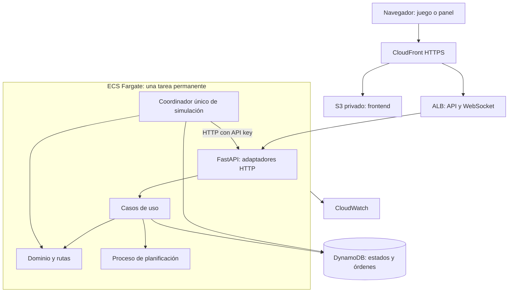

# Arquitectura del sistema

Estado: diseño adoptado para la primera implementación; no desplegado. Decisiones: [ADR-001](decisiones/0001-arquitectura-base.md), [ADR-002](decisiones/0002-dos-modos.md) y [ADR-003](decisiones/0003-estado-y-turnos.md).

La adopción de [PRD](PRD.md), [TRD](TRD.md), [ODDD](ODDD.md) y [SDD](SDD.md) complementa esta arquitectura sin cambiar stack o topología; decisión [ADR-005](decisiones/0005-prd-trd-oddd-sdd.md).

## Estructura y límites

Un núcleo modular compartido resuelve el mundo y sus reglas. Las políticas automática y humana producen intenciones; el mismo validador aplica movimientos, mordidas y llegadas. FastAPI transforma HTTP/WebSocket en operaciones de aplicación. La infraestructura persiste y publica; no define las reglas.

El diagrama describe flujo de ejecución. Las dependencias de código se definen en [módulos backend](modulos/backend.md): aplicación define los puertos de persistencia; los adaptadores los implementan. `RepositorioSnapshots` ya existe y su adaptador actual es solo local/en memoria; DynamoDB no está conectado. El dominio no importa FastAPI o boto3. La planificación CPU se aísla del servidor HTTP para no bloquearlo.

## Autoridad y concurrencia

- Solo el coordinador modifica posiciones y avanza el turno. Un endpoint recibe órdenes, no mueve personajes.
- Una partida activa, modo fijo y un `runId` nuevo en cada inicio. Una sola tarea inicialmente; no habilitar autoescalado del coordinador sin elección de líder.
- Instantáneas inmutables por partida, turno y fase. Preparar/persistir antes de anunciar el turno disponible.
- La caché es reconstruible; ni partida ni órdenes aceptadas dependen exclusivamente de memoria.
- Un estado real privado incluye dormidos y aleatoriedad. La proyección observable elimina información oculta y credenciales.
- Al reiniciar, recuperar una versión completa. No duplicar aplicación de órdenes o movimiento zombie. Si no se puede demostrar una reanudación coherente, marcar la partida interrumpida y reiniciar explícitamente, sin fingir continuidad.

## Comunicaciones

| Comunicación | Contrato | Confianza |
|---|---|---|
| Simulador → motor | `/paso` y estado técnico | API key de servicio. |
| Jugador → aplicación | Sesión temporal y órdenes por turno | Cookie de sesión, propiedad del personaje y validación de origen. |
| Panel → aplicación | Proyección observable | Lectura limitada; no usa credencial maestra. |
| Operador → simulador | Inicio/cierre/eventos | Credencial administrativa distinta. |
| Núcleo → almacenamiento | Puertos de aplicación | Rol IAM y adaptador de infraestructura. |

Los contratos públicos previstos están en [API](contratos/api.md) y [eventos](contratos/eventos.md). Identidades y almacenamiento, en [datos](datos.md).

## Límites y evolución

Una tarea no ofrece alta disponibilidad; los recursos iniciales y su capacidad deben medirse. Añadir Redis, réplicas o colas solo ante necesidad demostrada y registrar ADR. Una evolución multijugador deberá resolver propiedad de personajes, múltiples partidas, aislamiento y cuotas sin cambiar las reglas del mundo.

Evaluación de arquitectura: los siete criterios de separación de dependencias están cubiertos por el diseño (núcleo independiente, dependencias hacia dentro, persistencia sustituible, casos de uso sin HTTP, frameworks externos, grafo acíclico y ensamblaje en `main`). Su cumplimiento en código sigue pendiente; no hay puntuación de implementación verificable.
