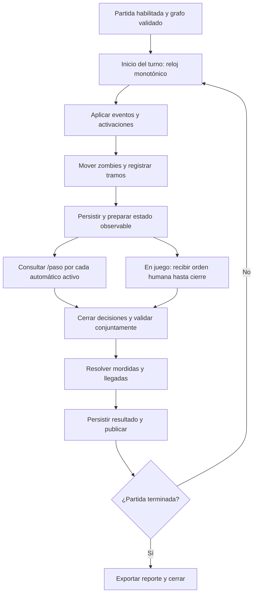

# Flujo del simulador y del turno

Estado: diseño previsto. Fuente de reglas: [reglas](../reglas-juego.md). Identidades: [datos](../datos.md).

## Ciclo

En modo simulador no hay ventana humana. Cada solicitud tiene menos de 500 ms desde su envío. Se preparan datos antes de enviar y se solicitan decisiones concurrentemente. Repeticiones de red no deben cambiar decisiones ni aplicar movimientos dos veces.

En juego, zombies se mueven al inicio; después se aceptan acciones sobre esa instantánea. Cierre humano provisional: 1,7 segundos desde el inicio, reservando 300 ms para resolver/publicar. El plazo HTTP automático no se convierte en plazo humano. Todos los movimientos se resuelven tras el cierre correspondiente, sin reubicar zombies entre la publicación y esa resolución.

La duración de procesamiento forma parte de los dos segundos. Planificar contra un plazo absoluto, no dormir dos segundos después de trabajar. Si el turno se retrasa, medirlo y registrar incumplimiento. No acumular avances instantáneos para ocultar retrasos ni pausar el mundo mientras se espera a un jugador.

## Fallos

- Decisión tardía o movimiento inválido: espera y contador de causa.
- No hay snapshot del turno: error medido; nunca usar silenciosamente otro turno.
- Persistencia fallida: no anunciar un estado confirmado que no pueda recuperarse.
- Reinicio: reanudar solo desde una fase confirmada y de forma idempotente; en caso contrario marcar interrupción.
- Mapa modificado por evento: invalidar planificación afectada antes de solicitar decisiones.

## Entrada y salida

Entrada: mapa validado, configuración de escenario, semilla, modo y eventos. Salida: estados versionados, decisiones recibidas, resultados y métricas. El estado aleatorio privado y las órdenes humanas registradas permiten reproducción; no se entregan al motor como conocimiento del futuro.
