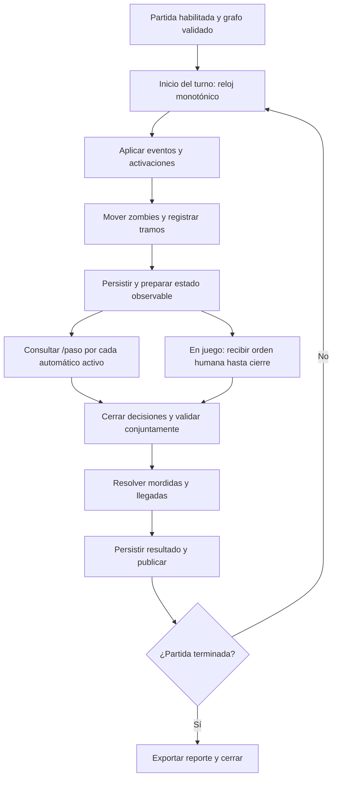

# Flujo del simulador y del turno

Estado: `resolver_turno()` y `avanzar_turno()` implementan en memoria movimiento zombie, cierres programados, decisiones y resolución conjunta con snapshots versionados. `EjecutarRondaAutomatica` orquesta una ronda: abre/retoma decisiones, consulta Dijkstra para sobrevivientes automáticos y confirma el resultado con CAS; puede repetirse explícitamente con la versión confirmada. `python -m navira.simulador_demo` ejecuta rondas sucesivas sobre la demo sintética y emite JSONL reproducible por semilla. No existe todavía bucle continuo, espera activa, persistencia durable ni publicación de transporte. Fuente de reglas: [reglas](../reglas-juego.md). Identidades: [datos](../datos.md).

## Ciclo

`preparar_turno_versionado()` aplica cierres y mueve zombies una vez, devolviendo el snapshot completo de decisiones con la versión esperada. `EjecutarRondaAutomatica` confirma la preparación antes de calcular intenciones; si se reintenta desde fase de decisiones, no mueve zombies de nuevo. Después confirma la resolución por una segunda versión. En juego, el futuro caso de uso debe persistir/publicar decisiones, recoger órdenes y después llamar a `resolver_turno_versionado()` sin volver a mover zombies. El reloj continuo, la publicación y el transporte aún no están conectados.

El ejecutor local comparte el contexto efímero de `navira.demo`, acepta límite de turnos, semilla y ruta opcional a un mapa compatible. Cada línea JSON incluye turno, versión del mapa, movimientos, mordidos, evacuados, activos y semilla. Se detiene al no quedar sobrevivientes activos o al alcanzar el límite. Es una herramienta de desarrollo: no duerme entre turnos, no mide el período de dos segundos, no publica estado y no convierte el mapa sintético en escenario oficial. Al repetir un comando se reinicia la partida desde cero.

En modo simulador no hay ventana humana. Cada solicitud tiene menos de 500 ms desde su envío. Se preparan datos antes de enviar y se solicitan decisiones concurrentemente. Repeticiones de red no deben cambiar decisiones ni aplicar movimientos dos veces.

En juego, zombies se mueven al inicio; después se aceptan acciones sobre esa instantánea. Cierre humano provisional: 1,7 segundos desde el inicio, reservando 300 ms para resolver/publicar. El plazo HTTP automático no se convierte en plazo humano. Todos los movimientos se resuelven tras el cierre correspondiente, sin reubicar zombies entre la publicación y esa resolución.

La duración de procesamiento forma parte de los dos segundos. `VentanaTurno` recibe el instante monotónico de inicio y deriva deadline, restante y retraso; no duerme ni programa la ejecución. El coordinador genera el snapshot de decisiones y el resultado antes de devolver la transición completa; aún no publica ni persiste. Planificar contra un plazo absoluto, no dormir dos segundos después de trabajar. Si el turno se retrasa, medirlo y registrar incumplimiento. No acumular avances instantáneos para ocultar retrasos ni pausar el mundo mientras se espera a un jugador.

## Fallos

- Decisión tardía o movimiento inválido: espera y contador de causa.
- No hay snapshot del turno: error medido; nunca usar silenciosamente otro turno.
- Persistencia fallida: no anunciar un estado confirmado que no pueda recuperarse. El control de versión del coordinador es un prechequeo local; el adaptador futuro debe aplicar compare-and-swap para evitar carreras reales.
- Reinicio: reanudar solo desde una fase confirmada y de forma idempotente; en caso contrario marcar interrupción.
- Mapa modificado por evento: invalidar planificación afectada antes de solicitar decisiones.

## Entrada y salida

Entrada: mapa validado, configuración de escenario, semilla, modo y eventos. Salida: estados versionados, decisiones recibidas, resultados y métricas. El estado aleatorio privado y las órdenes humanas registradas permiten reproducción; no se entregan al motor como conocimiento del futuro.
