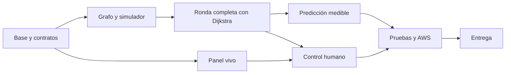

# Plan de implementación vigente

Estado: implementación por fases con ramas separadas; fases P0 y P1 están en curso. Última revisión: 2026-10-26. Fuentes: [contexto](contexto.md), [reto](referencias/reto-original.md) y [decisiones](decisiones/README.md). El [plan previo](referencias/plan-previo.md) es histórico; los documentos especializados actuales son la fuente de cada contrato o regla.

Nombre vigente: **Navira**. Al crear el backend usar la raíz propuesta `src/navira/`; la ruta del plan histórico no es una instrucción actual de nomenclatura. Las tareas funcionales y sus IDs se mantienen.

## Orden y dependencias

Configurar Budget en cuanto se disponga de acceso AWS; desplegar temprano, sin esperar a terminar todos los algoritmos. Los responsables indicados son funciones de equipo, no agentes creados automáticamente.

## Preparación metodológica

Intervención documental solicitada: [SPEC-006](especificaciones/SPEC-006-metodologia.md). No completa las fases de aplicación P0–P6.

| ID | Entregable | Estado | Evidencia |
|---|---|---|---|
| M0-01 | Auditar documentos, herramientas y alcance real | Verificado | CAM-004; lectura de repositorio y fuentes. |
| M0-02 | PRD/TRD, modelo OO + DDD, SDD, SPEC y plantillas | Verificado | Documentos y trazabilidad comprobados; SPEC-006. |
| M0-03 | Validadores y regresiones de trazabilidad | Verificado | Ocho regresiones correctas y validadores sin errores. |
| M0-04 | Validación, evidencia y transferencia | Verificado | CAM-004, reporte de SPEC-006 y estado actualizado. |

Elegir especificación y criterios antes de cada tarea; referencias de producto/técnicas en [trazabilidad](trazabilidad.md). La autorización actual cubre metodología; las funcionalidades siguen el alcance de la tarea de construcción que se solicite.

## Tareas

Estados permitidos: pendiente, en curso, verificado, bloqueado o descartado con motivo. «Verificado» exige evidencia; al interrumpir trabajo, registrar el estado real y el siguiente paso en [estado actual](estado-actual.md).

| ID | Entregable y responsable | Depende de | Aceptación | Estado |
|---|---|---|---|---|
| P0-01 | Base Python/FastAPI y configuración — backend | Lectura de `AGENTS.md` y `doc/` | Arranque local reproducible, secretos ficticios en ejemplos. | Verificado |
| P0-02 | Esquemas y fixtures — backend/dominio | P0-01 | `/paso` conserva contrato; mapa pequeño y errores definidos. | En curso |
| P0-03 | Budget, permisos y región — operación | Acceso AWS autorizado | Alerta real y evidencia sin datos sensibles. | Pendiente |
| P0-04 | CI y frontend mínimo — integración | P0-01 | Verificación Python y build frontend ejecutados. | Pendiente |
| P0-05 | Primer despliegue — operación | P0-03 y base mínima | URL pública de salud comprobada. | Pendiente |
| P1-01 | Grafo Manta y refugios — dominio | P0-02 | Unas 300 intersecciones, barrios conectados, distancias y direcciones válidas. Fixture 300 nodos con cuatro anclas tsunami generado; falta validar cobertura representativa y confirmar calles/amenazas. | En curso |
| P1-02 | Entidades, modos e intenciones — dominio | P0-02 | Un mundo y un resolutor para humano/automático. | En curso |
| P1-03 | Zombies y mordidas — simulación | P1-02 | T-01 a T-06 cubiertas, visibilidad validada y supuestos identificados. | En curso |
| P1-04 | Reloj, eventos y snapshots — simulación | P1-03 | Turnos versionados; bootstrap demo, caso de uso y CLI local completan rondas en memoria. Reloj continuo/durable pendientes. | En curso |
| P1-05 | Escenarios estocásticos — simulación | P1-01 y P1-04 | Demo genera semilla nueva si se omite, muestrea posiciones iniciales/fase de caminantes; replay multi-turno y posible divergencia de rutas entre semillas se prueban. Cohortes sintéticas 20/80/200 recorren tres turnos en el fixture Manta (CAM-025). Parcial: composición oficial P-09, reglas/eventos estocásticos, movimiento de horda P-07, persistencia/replay integral y evaluación HTTP/carga pendientes. | En curso |
| P2-01 | Dijkstra y selección de refugio — rutas | P1-01 | Núcleo genérico considera tipo/distancia, cierres y peligros visibles; falta validar mapa real. | En curso |
| P2-02 | `/paso` y API key — backend | P2-01 y P1-04 | Demo explícita recomienda ruta por HTTP sobre un snapshot activo; mundo oficial, idempotencia durable y operación completa pendientes. | En curso |
| P2-03 | Integración y referencia — integración | P2-02 y P1-05 | Una ronda completa; luego tres rondas y reporte base. CAM-028 añade evaluación HTTP loopback multi-turno para cohortes 20/80/200; falta reloj de 2 s, duración oficial y entorno remoto. | En curso |
| P3-01 | Búsqueda temporal acotada — rutas | P2-03 | Espera/avance, horizonte configurable y presupuesto medido. | Pendiente |
| P3-02 | Predicción de corredores — rutas | P3-01 | No conoce dormidos; compara varias semillas con referencia. | Pendiente |
| P3-03 | Selección de política — integración | P3-02 | Mejora demostrable sin romper latencia; conservar base si no mejora. | Pendiente |
| P4-01 | Panel y mapa — frontend | P0-04 y contratos | Capas, rutas, refugios, selección y métricas de modo. | Pendiente |
| P4-02 | WebSocket y recuperación — frontend/backend | P1-04 y P4-01 | Reconecta sin huecos ni mensajes de partida anterior. | Pendiente |
| P4B-01 | Sesión y aparición humana — backend | P2-03 | Un propietario, nodo aleatorio elegible y entrada al inicio de turno. | Pendiente |
| P4B-02 | Órdenes persistidas — backend | P4B-01 | Idempotencia, reemplazo, cierre y rechazo de sesión ajena. | Pendiente |
| P4B-03 | Controles, radio y resultado — frontend | P4-02 y P4B-02 | Jugable con teclado/mouse; un paso por turno y reconexión real. | Pendiente |
| P5-01 | Ráfagas y reloj — integración | P2-03 y política elegida | p95 objetivo ≤150 ms, errores <0,5 %, ciclo dentro de dos segundos. | Pendiente |
| P5-02 | Seguridad/red/TLS — operación | P0-05 y contratos finales | Permisos, origen y sesión probados; sin claves maestras en navegador. | Pendiente |
| P5-03 | Tres rondas en AWS — integración | P5-01, P5-02 y panel | Reportes con versión, origen de medición y resultados reales. | Pendiente |
| P5-04 | Juego y recuperación — integración | P4B-03 y P5-02 | T-12 a T-19; una recarga no revive ni duplica control. | Pendiente |
| P6-01 | README y evidencias — integración | Ejecución real | Instalación, API, despliegue y métricas reproducibles. | Pendiente |
| P6-02 | Diagrama/costos/Budget — operación | Recursos reales | SVG/PNG y fuente, cálculo completo y gasto real. | Pendiente |
| P6-03 | Pitch y entrega — equipo | P5-03, P5-04, P6-01, P6-02 | PDF/PPT ≤20 MB, enlaces públicos y entrega anticipada. | Pendiente |

Los objetivos son metas, no garantías ni resultados ya existentes. Detalles de aceptación en [pruebas](pruebas.md). El juego es parte del alcance solicitado; capacidad de refugios y camionetas no están comprometidas todavía.

## Cronograma propuesto

Fechas del reto: entrega miércoles 28-10-2026 a las 10:00, Ecuador continental. Ventanas orientativas heredadas del análisis; al retomarlas, contrastar hora/fecha reales y replanificar lo pendiente sin fingir que el trabajo previsto ya ocurrió.

| Ventana | Objetivo |
|---|---|
| Lunes 26 | Contratos, Budget, base, grafo y primera ronda integrada en AWS. |
| Martes 27, mañana | Reglas completas, tres escenarios, panel y entrada humana mínima. |
| Martes 27, tarde | Predicción, juego integrado, ráfagas y correcciones. |
| Martes 27, noche | Congelar funcionalidades y completar evidencia/documentación. |
| Miércoles 28, 07:30–09:00 | Verificación final y pitch. |
| Miércoles 28, 09:00–09:30 | Enviar y comprobar entrega. |
| Miércoles 28, 09:30–10:00 | Margen de incidencias. |

Equipo orientativo: A dominio/simulador; B rutas/API; C frontend/operación/documentación, con revisión compartida del despliegue. Con dos personas, dividir núcleo y producto/infraestructura. Con una, mantener pasos secuenciales y panel/juego mínimos; reducir primero extras y refinamientos.

## Recortes y bloqueos

- Sin una ronda completa, no empezar camionetas o capacidad.
- Si predicción empeora resultados, conservar política mejor medida y registrar comparación.
- Si CPU/latencia falla, revisar I/O y trabajo repetido, reducir horizonte y después dimensionar.
- Reducir efectos, personalización y ayudas avanzadas del juego antes de sus validaciones de control.
- Dudas externas no bloquean núcleo local; mantener supuestos configurables en [pendientes](pendientes.md).
- No crear Redis, colas, réplicas o nuevas capas sin problema demostrado y decisión registrada.

## Checklist de entrega

- [ ] Repositorio público e historial real de commits.
- [ ] README raíz reproducible con endpoint `/paso`, autenticación y medición.
- [ ] Simulador completo, mapa vivo y tres rondas en AWS.
- [ ] Selector de modos y juego humano mínimo verificado.
- [ ] Métricas del juego separadas de la prueba automática.
- [ ] Arquitectura exportada y fuente en `doc/`.
- [ ] Budget con alerta y evidencia en `doc/evidencias/`.
- [ ] Costo mensual completo y gasto real diferenciados.
- [ ] Supuestos y limitaciones conocidos, sin resultados inventados.
- [ ] Pitch válido, enlaces comprobados y URL disponible hasta la presentación.

El uso de `doc/` difiere de la estructura sugerida `docs/` del reto; el documento admite una estructura sugerida. README y entrega deben enlazar las ubicaciones reales.
