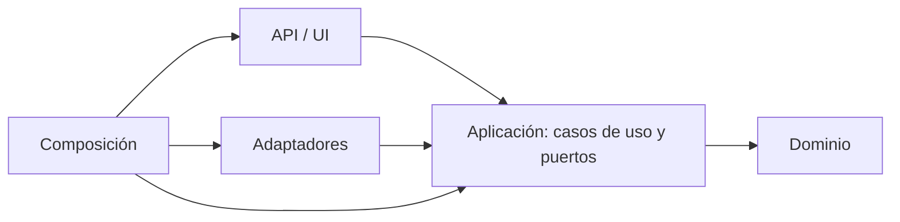

# Guía de Clean Architecture para backend y frontend

Estado: guía de destino y línea base, no una descripción del código actual. Decisión: [ADR-025](decisiones/0025-agentes-de-proyecto-y-clean-architecture.md). Refina nombres y capas de [arquitectura](arquitectura.md) y [módulos backend](modulos/backend.md) sin sustituirlos. Las líneas citadas son de 2026-10-26; si el código cambia, compara por contenido. Hechos: lote 1 (B1, B2, F1, F2, F6; CAM-067 y CAM-068) y lote 2 (B3 y F3; CAM-070), lote 3 (B4, B5 y B6; CAM-071, ADR-028) y lote 4 (F4 y F5; CAM-072). El paquete backend vive en `backend/src/navira/`: el aplanado de ADR-026 se revirtió ([ADR-027](decisiones/0027-reversion-del-aplanado-de-backend.md), CAM-069).

Esta guía la usan los subagentes `arquitecto-backend`, `arquitecto-frontend` y `revisor-arquitectura` (en `.claude/agents/`) y la skill `navira-clean-architecture`.

## Regla de dependencia

Las dependencias apuntan hacia dentro: el dominio no conoce a nadie, la aplicación conoce el dominio y define puertos, y los adaptadores implementan esos puertos.



Consecuencias verificables:
- Nada del núcleo importa FastAPI, boto3, React, `fetch` ni `WebSocket`.
- La aplicación no importa adaptadores ni la API.
- Los puertos son tipos (`Protocol` en Python, interfaces en TypeScript) definidos en la capa que los necesita.
- Solo la composición conoce implementaciones concretas.

## Backend

### Capas objetivo y carpetas actuales

Las carpetas son relativas a `backend/src/navira/` (paquete importable `navira`).

| Capa objetivo | Carpeta actual | Contenido que debe tener | Estado |
|---|---|---|---|
| Dominio | `domain/` | Grafo, entidades, estado de partida y `SnapshotMundo` | Cumple: `SnapshotMundo` vive en `domain/snapshot.py` (B2, CAM-067) |
| Dominio (algoritmos puros) | `routing/`, `simulation/` | Rutas, pronóstico y resolución de turnos; dependen solo de `domain` | Cumple; `simulation/coordinador.py` reexporta los tipos de `domain/snapshot.py` |
| Aplicación | `application/` | Casos de uso y puertos `Protocol` | Cumple en sesiones (B3); `juego.py` aún usa `secrets` y `random` por decisión (credencial y RNG del snapshot) |
| Adaptadores | `adapters/` | Implementaciones en memoria y futuras de los puertos | Cumple: `RepositorioSesionesMemoria` está en `adapters/sesiones_memoria.py` (B3, CAM-070) |
| API | `api/` | FastAPI: rutas, esquemas, autenticación, WebSocket | Cumple: `api/seguridad.py` (cookie y Origin), `api/dependencias.py` y helpers de error (B4, CAM-071); no lee el entorno |
| Composición | `main.py`, `demo.py` | Crea implementaciones concretas y las inyecta (`crear_control_simulador_demo` en `main.py`, B1) | Cumple: `main.py` es el único que lee el entorno (B4b); los escenarios viven en `simulation/escenarios.py` (B5, CAM-071) |
| Herramientas | `simulador_demo.py`, `carga_http.py`, `evaluacion_*.py` | Clientes del ensamblado, sin reglas propias | Cumple |

### Puertos existentes

| Puerto | Definido en | Implementación |
|---|---|---|
| `RepositorioSnapshots` | `application/snapshots.py:22` | `AlmacenSnapshotsMemoria` en `adapters/snapshots_memoria.py:15` |
| `RepositorioOrdenes` | `application/ordenes.py:35` | `RepositorioOrdenesMemoria` en `adapters/ordenes_memoria.py:14` |
| `ProveedorMapas` | `application/puertos_paso.py` (B6, CAM-071; `decidir_paso` lo reexporta) | `CatalogoMapasMemoria` en `adapters/mapas_memoria.py:10` |
| `RepositorioSesiones` | `application/juego.py` | `RepositorioSesionesMemoria` en `adapters/sesiones_memoria.py` (B3, CAM-070) |

### Línea base de violaciones (2026-10-26, actualizada tras CAM-071)

Cerradas: la importación de `navira.demo` desde `application/control_simulador_demo.py` (B1), la ubicación de `SnapshotMundo` en `simulation/` (B2) el repositorio de sesiones en `application/` (B3, CAM-070), y las tres filas de la tabla siguiente (B4, B5 y B6, CAM-071). Deuda residual: los importadores siguen usando la fachada `decidir_paso` (migrarlos y retirar sus `noqa F401`); `ESCENARIOS` es mutable; `tests/test_decidir_paso.py:28` y `tests/test_api_planner_integration.py:15` importan aún desde `simulation.coordinador`; quitar el reexport cuando migren. El puerto `ContextoSimulacion` declara `intensidad: str` y `crear_contexto_demo` lanza `ValueError`.

| Regla | Violación | Severidad |
|---|---|---|
| La API no tiene reglas | Cerrada (B4, CAM-071): seguridad en `api/seguridad.py`, configuración inyectada | Cerrada |
| La composición no genera escenarios | Cerrada (B5, CAM-071): `simulation/escenarios.py` | Cerrada |
| Un módulo, un propósito | Cerrada (B6, CAM-071): `domain/visibilidad.py` y `application/puertos_paso.py`; `decidir_paso.py` queda en 503 líneas | Cerrada, con deuda de fachada |

### Pasos de migración del backend

Cada paso se hace solo, con sus pruebas en verde antes de empezar el siguiente. Ninguno cambia el contrato de `POST /paso` ni la ocultación de dormidos y RNG.

| Paso | Qué mueve | Riesgo | Pruebas a mantener | Documento a actualizar |
|---|---|---|---|---|
| B1 (hecho, CAM-067) | `control_simulador_demo` recibe una fábrica de contexto inyectada desde `main.py` y deja de importar `demo` | Bajo | `test_control_simulador_demo.py`, `test_demo.py` | `modulos/backend.md`, CAM |
| B2 (hecho, CAM-067) | `SnapshotMundo` pasa a `domain` y `simulation` lo reexporta | Medio | `test_coordinador.py`, `test_snapshots_persistidos.py`, `test_panel.py` | `modulos/backend.md`, `datos.md`, CAM |
| B3 (hecho, CAM-070) | `RepositorioSesionesMemoria` a `adapters/`; reloj y generador de id inyectados (`secrets` y `random` no, por decisión) | Medio | `test_juego_sesion.py`, `test_ordenes_juego.py` | `contratos/api.md` si cambia el comportamiento, `modulos/backend.md`, CAM |
| B4 (hecho, CAM-071, ADR-028) | `api/routes.py`: helper de errores, dependencias tipadas en lugar de `getattr` y política de seguridad en un módulo propio | Medio-alto | `test_api_http.py`, `test_panel.py`, `test_juego_sesion.py` | `contratos/api.md` (sin cambiar códigos HTTP), CAM |
| B5 (hecho, CAM-071) | Generación de escenarios de `demo.py` a `simulation/` o `domain/` | Medio | `test_demo.py`, `test_simulacion_mapa_manta.py` | `modulos/backend.md`, CAM |
| B6 (hecho, CAM-071) | `decidir_paso.py` se parte en caso de uso, puertos y visibilidad | Alto | `test_decidir_paso.py`, `test_prediccion_rutas.py`, `test_ruta_temporal.py` | `modulos/backend.md`, CAM |

## Frontend

### Capas objetivo y carpetas actuales

| Capa objetivo | Carpeta destino | Contenido | Equivalente actual |
|---|---|---|---|
| Dominio | `src/domain/` | Tipos del producto, reglas puras y parsers de respuesta | `src/domain/{panel,game,simulator}.ts` (F2, CAM-068; reglas de juego en `game.ts`, F4) |
| Aplicación | `src/application/` | Hooks que orquestan casos de uso (`usePanel`, `useSimulator`) y puertos | `src/application/{ports,usePanel,useSimulator,useGameSession}.ts` (F3, CAM-070; F4, CAM-072) |
| Infraestructura | `src/infrastructure/` | Clientes HTTP y WebSocket | `src/infrastructure/http/{health,panel,game,simulator}.ts` y `src/infrastructure/realtime/panel.ts` (F1, F2) |
| Presentación | `src/features/`, `src/shared/ui/` | Componentes React y mapa | `features/` y `shared/ui/`; geometría en `features/map/mapFeatures.ts` (F5, CAM-072) |
| Composición | `src/app/` | Monta los hooks y los componentes | `app/App.tsx` (168 líneas; compone hooks con puertos, F3) |

### Línea base de violaciones (2026-10-26, actualizada tras CAM-072)

Cerradas: `fetch('/salud')` en `App.tsx` (F1), la dependencia del WebSocket sobre `shared/api` y el archivo mixto `shared/api/panel.ts` (F2), y la orquestación de estado y efectos de `App.tsx` (F3, CAM-070). la lógica de `GameControls` (F4, CAM-072) y la geometría de `CityMap` (F5, CAM-072). Sin violaciones abiertas salvo las aceptadas: `import type GameSessionView` desde `application` en `GameControls`, `isRecord` copiado en 6 sitios y la revisión visual en navegador de F3, F4 y F5 (pendiente del usuario).

| Regla | Violación | Severidad |
|---|---|---|
| La lógica de negocio no vive en componentes | Cerrada (F4, CAM-072): `domain/game.ts` y `application/useGameSession.ts` | Cerrada |
| Geometría fuera de la presentación | Cerrada (F5, CAM-072): `features/map/mapFeatures.ts` | Cerrada |

El frontend tiene pruebas vitest de dominio (`npm test`, 59 pruebas en 6 archivos, F6, F3, F4 y F5) y `npm run build`; no hay lint.

### Pasos de migración del frontend

| Paso | Qué mueve | Riesgo | Cómo se verifica | Documento a actualizar |
|---|---|---|---|---|
| F1 (hecho, CAM-068) | `fetch('/salud')` de `App.tsx` a `infrastructure/http/health.ts` | Bajo | `npm run build` y el tablero abre | `modulos/frontend.md`, CAM |
| F2 (hecho, CAM-068) | Tipos y parsers de `panel.ts` a `domain/`; `fetch` a `infrastructure/http/` | Medio | `npm run build` | `modulos/frontend.md`, CAM |
| F3 (hecho, CAM-070) | Extraer `usePanel` y `useSimulator` de `App.tsx` | Medio | `npm test` (27) y `npm run build`; los hooks no tienen prueba unitaria | `modulos/frontend.md`, CAM |
| F4 (hecho, CAM-072) | Reglas puras de `GameControls` a `domain/game.ts` y orquestación a `useGameSession` | Medio | `npm test` (59) y `npm run build`; revisión visual pendiente | `modulos/frontend.md`, CAM |
| F5 (hecho, CAM-072) | Geometría de `CityMap` a `features/map/mapFeatures.ts` | Bajo | `mapFeatures.test.ts` (9), `npm run build`; revisión visual pendiente | `modulos/frontend.md`, CAM |
| F6 (pruebas hechas, CAM-068; lint pendiente) | Añadir pruebas (vitest) y lint | Decisión aparte | `npm test` (vitest 5.0.5) | `pruebas.md`, `SDD.md`, CAM |

F6 fue una decisión aparte; se añadió solo vitest, sin lint.

## Comprobaciones automáticas

Las búsquedas que usa `revisor-arquitectura`, desde la raíz del repositorio:

```bash
rg -n "fastapi|boto3|navira\.(api|adapters|demo|main)" backend/src/navira/domain backend/src/navira/routing backend/src/navira/simulation backend/src/navira/application
rg -n "fastapi|navira\.api" backend/src/navira/adapters
rg -n "fetch\(|new WebSocket\(" frontend/src
```

La primera debe dar solo las violaciones heredadas de la línea base; cualquier coincidencia nueva es una violación. En el frontend, `fetch` y `WebSocket` solo pueden aparecer en `src/infrastructure/` (tras F2).

## Lo que no cambia

- Contrato de `POST /paso`: nombre, método, campos, respuesta de éxito y `x-api-key`.
- Límite de 500 ms de `/paso` (R-11).
- Ocultación de zombies dormidos y de estado RNG en panel, WebSocket, routing y respuestas.
- Servidor autoritativo: el navegador no modifica el mundo.
- Una partida activa y un jugador humano por partida, como límites iniciales.
