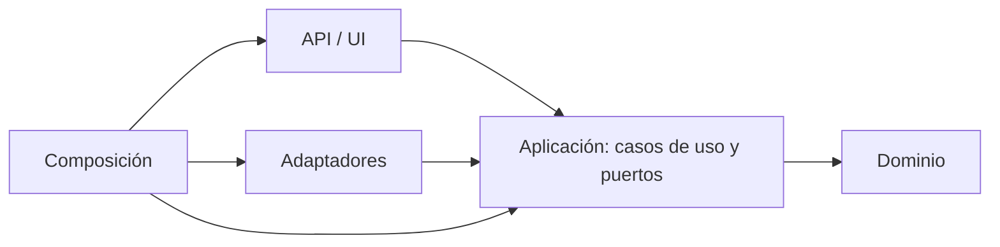

# Guía de Clean Architecture para backend y frontend

Estado: guía de destino y línea base, no una descripción del código actual. Decisión: [ADR-025](decisiones/0025-agentes-de-proyecto-y-clean-architecture.md). Refina nombres y capas de [arquitectura](arquitectura.md) y [módulos backend](modulos/backend.md) sin sustituirlos. Las líneas citadas son de 2026-10-26; si el código cambia, compara por contenido.

Esta guía la usan los subagentes `arquitecto-backend`, `arquitecto-frontend` y `revisor-arquitectura` (en `.claude/agents/`) y la skill `navira-clean-architecture`.

## Regla de dependencia

Las dependencias apuntan hacia dentro: el dominio no conoce a nadie, la aplicación conoce el dominio y define puertos, y los adaptadores implementan esos puertos.



Consecuencias verificables:
- Nada del núcleo importa FastAPI, boto3, React, `fetch` ni `WebSocket`.
- La aplicación no importa adaptadores ni la API.
- Los puertos son tipos (`Protocol` en Python, interfaces en TypeScript) definidos en la capa que los necesita.
- Solo la composición conoce implementaciones concretas.

## Backend

### Capas objetivo y carpetas actuales

| Capa objetivo | Carpeta actual | Contenido que debe tener | Estado |
|---|---|---|---|
| Dominio | `domain/` | Grafo, entidades, estado de partida y `SnapshotMundo` | Parcial: `SnapshotMundo` vive en `simulation/` (B2) |
| Dominio (algoritmos puros) | `routing/`, `simulation/` | Rutas, pronóstico y resolución de turnos; dependen solo de `domain` | Cumple, salvo la importación de `SnapshotMundo` |
| Aplicación | `application/` | Casos de uso y puertos `Protocol` | Mezcla casos de uso con infraestructura (reloj, repositorio en memoria) |
| Adaptadores | `adapters/` | Implementaciones en memoria y futuras de los puertos | Parcial: `RepositorioSesiones` está en `application/` (B3) |
| API | `api/` | FastAPI: rutas, esquemas, autenticación, WebSocket | Hace demasiado: cookies, origen y errores mezclados (B4) |
| Composición | `main.py`, `demo.py` | Crea implementaciones concretas y las inyecta | `demo.py` también genera escenarios (B5) |
| Herramientas | `simulador_demo.py`, `carga_http.py`, `evaluacion_*.py` | Clientes del ensamblado, sin reglas propias | Cumple |

### Puertos existentes

| Puerto | Definido en | Implementación |
|---|---|---|
| `RepositorioSnapshots` | `application/snapshots.py:22` | `AlmacenSnapshotsMemoria` en `adapters/snapshots_memoria.py:15` |
| `RepositorioOrdenes` | `application/ordenes.py:35` | `RepositorioOrdenesMemoria` en `adapters/ordenes_memoria.py:14` |
| `ProveedorMapas` | `application/decidir_paso.py:76` | `CatalogoMapasMemoria` en `adapters/mapas_memoria.py:10` |
| `RepositorioSesiones` | `application/juego.py:47` | Sin adaptador propio: `RepositorioSesionesMemoria` está en `application/juego.py:57` |

### Línea base de violaciones (2026-10-26)

| Regla | Violación | Severidad |
|---|---|---|
| El núcleo no importa la composición | `application/control_simulador_demo.py:11` importa `navira.demo` | Dura |
| El núcleo no importa adaptadores | `demo.py:16-17` importa `adapters` y `application` depende de `demo` | Dura (transitiva) |
| El dominio posee sus tipos | `SnapshotMundo` está en `simulation/coordinador.py:49` y lo usan `application/snapshots.py:9`, `juego.py:29` y `consultar_panel.py:12` | Menor |
| La aplicación no tiene infraestructura | `RepositorioSesionesMemoria` en `application/juego.py:57`; `random`, `time`, `secrets` y `uuid` en `juego.py:5-11` | Menor |
| La API no tiene reglas | Cookies, origen y mapeo de errores en `api/routes.py:159-296` y `:370-440`; `os.getenv` en `routes.py:190` | Menor |
| La composición no genera escenarios | `demo.py:235-376` (zombis, composición, eventos) | Menor |
| Un módulo, un propósito | `application/decidir_paso.py` (574 líneas): caso de uso, excepciones, puertos y utilidades de visibilidad (`peligros_visibles` :521, `nodos_horda_visibles` :551) | Menor |

### Pasos de migración del backend

Cada paso se hace solo, con sus pruebas en verde antes de empezar el siguiente. Ninguno cambia el contrato de `POST /paso` ni la ocultación de dormidos y RNG.

| Paso | Qué mueve | Riesgo | Pruebas a mantener | Documento a actualizar |
|---|---|---|---|---|
| B1 | `control_simulador_demo` recibe una fábrica de contexto inyectada desde `main.py` y deja de importar `demo` | Bajo | `test_control_simulador_demo.py`, `test_demo.py` | `modulos/backend.md`, CAM |
| B2 | `SnapshotMundo` pasa a `domain` y `simulation` lo reexporta | Medio | `test_coordinador.py`, `test_snapshots_persistidos.py`, `test_panel.py` | `modulos/backend.md`, `datos.md`, CAM |
| B3 | `RepositorioSesionesMemoria` a `adapters/`; reloj y aleatorio inyectados | Medio | `test_juego_sesion.py`, `test_ordenes_juego.py` | `contratos/api.md` si cambia el comportamiento, `modulos/backend.md`, CAM |
| B4 | `api/routes.py`: helper de errores, dependencias tipadas en lugar de `getattr` y política de seguridad en un módulo propio | Medio-alto | `test_api_http.py`, `test_panel.py`, `test_juego_sesion.py` | `contratos/api.md` (sin cambiar códigos HTTP), CAM |
| B5 | Generación de escenarios de `demo.py` a `simulation/` o `domain/` | Medio | `test_demo.py`, `test_simulacion_mapa_manta.py` | `modulos/backend.md`, CAM |
| B6 | `decidir_paso.py` se parte en caso de uso, puertos y visibilidad | Alto | `test_decidir_paso.py`, `test_prediccion_rutas.py`, `test_ruta_temporal.py` | `modulos/backend.md`, CAM |

## Frontend

### Capas objetivo y carpetas actuales

| Capa objetivo | Carpeta destino | Contenido | Equivalente actual |
|---|---|---|---|
| Dominio | `src/domain/` | Tipos del producto, reglas puras y parsers de respuesta | Tipos y parsers de `shared/api/panel.ts`, `game.ts`, `simulator.ts` |
| Aplicación | `src/application/` | Hooks que orquestan casos de uso (`usePanel`, `useSimulator`) | Lógica de `App.tsx:36-149` |
| Infraestructura | `src/infrastructure/` | Clientes HTTP y WebSocket | `shared/api/*.ts` (fetch) y `shared/realtime/panel.ts` |
| Presentación | `src/features/`, `src/shared/ui/` | Componentes React y mapa | `features/` y `shared/ui/` |
| Composición | `src/app/` | Monta los hooks y los componentes | `app/App.tsx` (solo después de B) |

### Línea base de violaciones (2026-10-26)

| Regla | Violación | Severidad |
|---|---|---|
| Ningún componente llama a la red | `App.tsx:143` hace `fetch('/salud')` con `setInterval` de 5 s | Dura |
| El dominio no depende de transporte | `shared/realtime/panel.ts:1` importa `parsePanelState` desde `shared/api/panel.ts` | Menor |
| La lógica de negocio no vive en componentes | `GameControls.tsx:36-57` (movimientos legales y sugerencia de radio), `:72-99` (códigos 403 y 410) y `:130-139` (construcción de la orden) | Menor |
| Estado y orquestación fuera de componentes | `App.tsx:36-96` (secuencias, versión del mapa) y `:100-149` (efectos); 14 `useState` en `App.tsx:14-32` | Menor |
| Geometría fuera de la presentación | `CityMap.tsx:270-375` (`createSimulationFeatures`, `createActorFeatures`, `createMovementAnimations`, `positionAlongPath`) | Menor |
| Un archivo, un propósito | `shared/api/panel.ts` junta tipos (1-31), `fetch` (33-59) y parsers (61-151) | Menor |

No hay pruebas ni lint en el frontend; la única verificación es `npm run build`.

### Pasos de migración del frontend

| Paso | Qué mueve | Riesgo | Cómo se verifica | Documento a actualizar |
|---|---|---|---|---|
| F1 | `fetch('/salud')` de `App.tsx` a `infrastructure/http/health.ts` | Bajo | `npm run build` y el tablero abre | `modulos/frontend.md`, CAM |
| F2 | Tipos y parsers de `panel.ts` a `domain/`; `fetch` a `infrastructure/http/` | Medio | `npm run build` | `modulos/frontend.md`, CAM |
| F3 | Extraer `usePanel` y `useSimulator` de `App.tsx` | Medio | `npm run build` y revisión manual del tablero | `modulos/frontend.md`, CAM |
| F4 | Reglas puras de `GameControls` a `domain/juego.ts` | Medio | `npm run build`; pendiente de prueba unitaria | `modulos/frontend.md`, CAM |
| F5 | Geometría de `CityMap` a un módulo puro | Bajo | `npm run build` y revisión visual del mapa | `modulos/frontend.md`, CAM |
| F6 | Añadir pruebas (vitest) y lint | Decisión aparte | Necesita aprobación del usuario | `pruebas.md`, `SDD.md`, CAM |

F6 no se hace dentro de la migración: añadir dependencias es una decisión propia.

## Comprobaciones automáticas

Las búsquedas que usa `revisor-arquitectura`, desde la raíz del repositorio:

```bash
rg -n "fastapi|boto3|navira\.(api|adapters|demo|main)" backend/src/navira/domain backend/src/navira/routing backend/src/navira/simulation backend/src/navira/application
rg -n "fastapi|navira\.api" backend/src/navira/adapters
rg -n "fetch\(|new WebSocket\(" frontend/src
```

La primera debe dar solo las violaciones heredadas de la línea base; cualquier coincidencia nueva es una violación. En el frontend, `fetch` y `WebSocket` solo pueden aparecer en `shared/api/`, `shared/realtime/` o, después de F2, en `infrastructure/`.

## Lo que no cambia

- Contrato de `POST /paso`: nombre, método, campos, respuesta de éxito y `x-api-key`.
- Límite de 500 ms de `/paso` (R-11).
- Ocultación de zombies dormidos y de estado RNG en panel, WebSocket, routing y respuestas.
- Servidor autoritativo: el navegador no modifica el mundo.
- Una partida activa y un jugador humano por partida, como límites iniciales.
