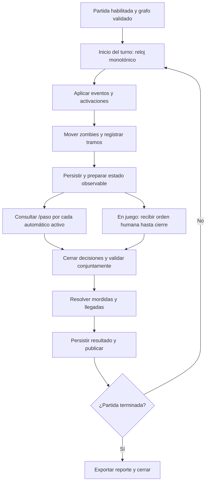

# Flujo del simulador y del turno

Estado: `resolver_turno()` y `avanzar_turno()` implementan en memoria movimiento zombie, cierres programados, decisiones y resolución conjunta con snapshots versionados. `EjecutarRondaAutomatica` orquesta una ronda: abre/retoma decisiones, consulta la política temporal riesgo-primero con fallback Dijkstra y escape de un paso si no hay ruta completa (CAM-059) para sobrevivientes automáticos y confirma el resultado con CAS; solo los sobrevivientes activos son elegibles para mordida y una evacuación confirmada es terminal (CAM-060). Puede repetirse explícitamente con la versión confirmada. En el control local, panel y ejecutor comparten planificador y caché para que la vista previa coincida con la primera acción. `python -m navira.simulador_demo` ejecuta rondas sucesivas en perfiles sintéticos (`libre`, `caminantes`, `mixto`, `horda`) y emite JSONL reproducible por semilla. No son las rondas oficiales y no existe todavía bucle continuo, espera activa, persistencia durable ni publicación de transporte. Fuente de reglas: [reglas](../reglas-juego.md). Identidades: [datos](../datos.md).

## Ciclo

`preparar_turno_versionado()` aplica cierres y mueve zombies una vez, devolviendo el snapshot completo de decisiones con la versión esperada. `EjecutarRondaAutomatica` confirma la preparación antes de calcular intenciones; si se reintenta desde fase de decisiones, no mueve zombies de nuevo. Después confirma la resolución por una segunda versión. En juego, el futuro caso de uso debe persistir/publicar decisiones, recoger órdenes y después llamar a `resolver_turno_versionado()` sin volver a mover zombies. El reloj continuo, la publicación y el transporte aún no están conectados.

CAM-039/040 implementan `CoordinadorJuego`, `PuertaDecisiones` y `RelojJuegoLocal` para la demo opt-in. El runner inicia cada ciclo con reloj monotónico, prepara zombies, abre órdenes hasta `inicio + 1,7 s`, rechaza órdenes nuevas al vencer, consume la última orden humana o espera, decide NPC y confirma una resolución CAS. Al cerrar app, el hilo se detiene. El valor de 2 s es nominal y se verificó en una ronda HTTP local, no como cadencia sostenida ni bajo carga. Este runner de memoria no recupera tras reinicio y no debe desplegarse en varias réplicas.

El ejecutor local comparte el contexto efímero de `navira.demo`, acepta perfil, población de 1 a 200, límite de turnos, semilla opcional y ruta a un mapa compatible, incluido el fixture de Manta. Si se omite semilla, genera una semilla de 64 bits desde la entropía del sistema; el JSONL registra la semilla efectiva para permitir replay. Con semilla fija, asigna posiciones iniciales reproducibles a sobrevivientes y zombies y fase inicial de caminantes; en mapas pequeños varios personajes pueden compartir posición. La composición de cada perfil sigue fija y sintética. Cada línea JSON incluye turno, versión del mapa, perfil, tamaño inicial, movimientos observables, mordidos, evacuados, activos y semilla; omite posiciones de zombies que siguen dormidos. Se detiene al no quedar sobrevivientes activos o al alcanzar el límite. Es una herramienta de desarrollo: no genera carga HTTP, no duerme entre turnos, no mide el período de dos segundos, no publica estado y no convierte el mapa sintético en escenario oficial. CAM-025 documenta una exploración de tres turnos sobre el fixture de Manta, no una evaluación real. Al repetir un comando se reinicia la partida desde cero.

CAM-057 amplía la configuración del control local con intensidades sintéticas baja/media/alta (6/14/25 % de nodos elegibles disponibles) y muestreo por sectores geográficos; los porcentajes describen dificultad del prototipo, no estimaciones de Manta. `mixto` reparte caminantes, corredores, hordas y dormidos; `horda` favorece hordas/dormidos; los dormidos continúan ocultos hasta activarse. En el control local los incidentes viales se generan siempre: al crear cada partida, el RNG privado sortea entre 1 y 10 segmentos distintos, con aplicaciones espaciadas cada tres turnos desde el turno 2; la cantidad ya no depende de la intensidad zombie (CAM-082/ADR-033). El coordinador aplica el cierre antes del movimiento zombie y de abrir decisiones, por lo que la recomendación del mismo snapshot ya evita el segmento. El snapshot privado conserva el calendario reproducible; el panel publica la ubicación y alerta solo tras confirmar la aplicación. El operador no tiene ajuste para desactivarlos (CAM-081/ADR-032). La CLI y las evaluaciones directas pueden elegir su configuración explícitamente. No se simulan terremotos ni tsunamis. Detalle y límites en [ADR-017](../../arquitectura/decisiones/0017-perfiles-sinteticos-de-amenazas.md).

CAM-079 establece 4× como velocidad inicial del reloj **solo en la demo local**; desde CAM-100 queda fija y el tablero ya no ofrece un selector. El intervalo objetivo es 0,5 s por ronda. El runner resuelve cada ronda completa y de forma secuencial: una carga que supere el intervalo retrasa la siguiente ronda, nunca la omite. La animación ocupa como mínimo el periodo nominal y se adapta a la cadencia del turno observada en el navegador, ignorando pausas superiores a 5 s. El mapa conserva una animación si llegan snapshots de otras fases sin movimientos nuevos. El navegador no predice ni confirma acciones. La velocidad/cadencia oficial de evaluación permanece separada y no cambia.

CAM-057 amplía la configuración del control local con intensidades sintéticas baja/media/alta (6/14/25 % de nodos elegibles disponibles) y muestreo por sectores geográficos; los porcentajes describen dificultad del prototipo, no estimaciones de Manta. `mixto` reparte caminantes, corredores, hordas y dormidos; `horda` favorece hordas/dormidos; los dormidos continúan ocultos hasta activarse. En el control local los incidentes viales se generan siempre: al crear cada partida, el RNG privado sortea entre 1 y 10 segmentos distintos, con aplicaciones espaciadas cada tres turnos desde el turno 2; la cantidad ya no depende de la intensidad zombie (CAM-082/ADR-033). El coordinador aplica el cierre antes del movimiento zombie y de abrir decisiones, por lo que la recomendación del mismo snapshot ya evita el segmento. El snapshot privado conserva el calendario reproducible; el panel publica la ubicación y alerta solo tras confirmar la aplicación. El operador no tiene ajuste para desactivarlos (CAM-081/ADR-032). La CLI y las evaluaciones directas pueden elegir su configuración explícitamente. No se simulan terremotos ni tsunamis. Detalle y límites en [ADR-017](../../arquitectura/decisiones/0017-perfiles-sinteticos-de-amenazas.md).

En modo simulador no hay ventana humana. Cada solicitud tiene menos de 500 ms desde su envío. Se preparan datos antes de enviar y se solicitan decisiones concurrentemente. Repeticiones de red no deben cambiar decisiones ni aplicar movimientos dos veces.

En juego, zombies se mueven al inicio; después se aceptan acciones sobre esa instantánea. Cierre humano provisional: 1,7 segundos desde el inicio, reservando 300 ms para resolver/publicar. El plazo HTTP automático no se convierte en plazo humano. Todos los movimientos se resuelven tras el cierre correspondiente, sin reubicar zombies entre la publicación y esa resolución.

La duración de procesamiento forma parte de los dos segundos. `VentanaTurno` recibe el instante monotónico de inicio y deriva deadline, restante y retraso; no duerme ni programa la ejecución. El coordinador genera el snapshot de decisiones y el resultado antes de devolver la transición completa; aún no publica ni persiste. Planificar contra un plazo absoluto, no dormir dos segundos después de trabajar. Si el turno se retrasa, medirlo y registrar incumplimiento. No acumular avances instantáneos para ocultar retrasos ni pausar el mundo mientras se espera a un jugador.

## Fallos

- Decisión tardía o movimiento inválido: espera y contador de causa.
- No hay snapshot del turno: error medido; nunca usar silenciosamente otro turno.
- Persistencia fallida: no anunciar un estado confirmado que no pueda recuperarse. El control de versión del coordinador es un prechequeo local; el adaptador futuro debe aplicar compare-and-swap para evitar carreras reales.
- Reinicio: reanudar solo desde una fase confirmada y de forma idempotente; en caso contrario marcar interrupción.
- Mapa modificado por evento: invalidar planificación afectada antes de solicitar decisiones.

## Entrada y salida

Entrada: mapa validado, configuración de escenario, semilla, modo y eventos. Salida: estados versionados, decisiones recibidas, resultados y métricas. El estado aleatorio privado y las órdenes humanas registradas permiten reproducción; no se entregan al motor como conocimiento del futuro.
