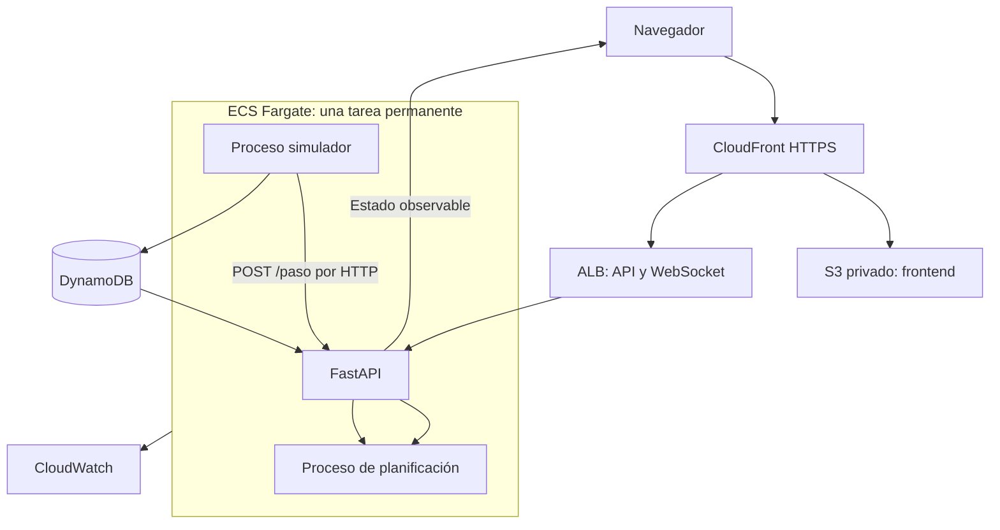

# Referencia histórica — plan previo a la documentación modular

Estado: histórico, conservado el 26 de octubre de 2026. Este documento registra la propuesta anterior; no debe actualizarse para describir el estado actual. El plan vigente es [plan-implementacion.md](../seguimiento/plan-implementacion.md), el índice está en [README.md](../README.md) y los cambios posteriores se registran en [cambios.md](../seguimiento/cambios.md).

# Plan de implementación — MantaSafe: simulador y juego

Documento de planificación. El proyecto todavía no está implementado ni desplegado.

Fecha de referencia: lunes 26 de octubre de 2026, Ecuador continental (UTC−5).
Entrega según el reto: miércoles 28 de octubre, 10:00. Demo: viernes 30.
Supuesto de organización: dos o tres integrantes. Si trabaja una sola persona, mantener el orden de las fases y eliminar primero los extras.

## 1. Resultado que vamos a entregar

Una aplicación desplegada en AWS con dos modos sobre el mismo apocalipsis y grafo de Manta. En modo simulador, el motor controla a los sobrevivientes consultando `POST /paso` por cada sobreviviente activo. En modo juego, una persona controla a su propio personaje y los demás sobrevivientes siguen siendo automáticos. Ambos usan las mismas reglas, reloj, mordidas, eventos y refugios.

La prioridad es completar el nivel base y la prueba de fuego con mediciones reproducibles. La predicción se añade después de disponer de una referencia funcional contra la que medirla.

### Alcance comprometido

- Grafo conectado de unas 300 intersecciones, cuatro refugios y calles con distancia y tipo.
- Simulador con turnos de dos segundos, cuatro tipos de zombies, eventos y detección de mordidas.
- Contrato exacto de `/paso`, autenticación `x-api-key` y estado observable por `/estado` o WebSocket; implementaremos ambos.
- Ruta inicial con Dijkstra; mejora mediante búsqueda temporal de horizonte limitado.
- Panel con mapa, rutas, eventos, contadores y estado de conexión.
- Selector inicial entre «Simulador» y «Jugar», personaje humano con aparición aleatoria válida, movimiento por calles y llegada al refugio.
- Despliegue AWS, Budget con alerta, métricas, documentación y pitch.

### Extras condicionados a resultados

1. Predicción de corredores: primer objetivo adicional, por su impacto en supervivencia.
2. Capacidad y reservas en refugios: solo con el nivel base estable.
3. Camionetas: únicamente si lo anterior ya está validado y entregable.

### Fuera de alcance inicial

Aplicación móvil, cuentas permanentes de usuario, LLM para decidir movimientos, entrenamiento de modelos, tráfico real, múltiples partidas simultáneas, multijugador cooperativo simultáneo y arquitectura de microservicios. La primera versión admite un jugador humano activo por partida; varias personas pueden probarla por turnos.

### 1.1. Experiencia de los dos modos

| Aspecto | Simulador | Juego |
|---|---|---|
| Objetivo | Evaluar el motor con 20, 80 o 200 sobrevivientes. | Llevar tu personaje desde una intersección aleatoria hasta un refugio. |
| Control | Todos los sobrevivientes son automáticos. | Un personaje humano; el resto automático. |
| Interfaz | Vista global, escenarios, métricas y rutas. | Mapa centrado en el personaje, calles posibles, cuenta atrás y refugios. |
| Decisión | `/paso` determina cada movimiento. | El jugador elige un vecino o espera; puede consultar la sugerencia del motor. |
| Resultado | Reporte reproducible de las rondas. | Victoria al evacuar, derrota por mordida y resumen de turnos recorridos. |
| Evaluación oficial | Tres rondas automáticas con las cantidades del reto. | Experiencia complementaria con métricas propias. |

Flujo mínimo del juego:

1. Elegir «Jugar» y un alias opcional, sin registro permanente.
2. El servidor crea una sesión y asigna un personaje en un nodo aleatorio elegible.
3. Mostrar «Estás aquí», refugios, calles vecinas disponibles y tiempo hasta el siguiente movimiento.
4. Elegir una calle con el mouse, tocar un botón de destino o usar Tab y Enter; ofrecer «Esperar».
5. Mostrar la orden como pendiente; el personaje solo cambia de nodo cuando el servidor resuelve el turno.
6. Al llegar o recibir una mordida, mostrar el resultado y ofrecer otra partida cuando corresponda.

El jugador se mueve por intersecciones, una calle por turno. La animación puede interpolar entre coordenadas, pero no concede movimiento libre ni pasos adicionales. Los controles deben tener foco visible y etiquetas; el color no será el único indicador de peligro o selección.

La sugerencia del motor se presenta como una ayuda opcional: «Radio: paso recomendado». No mueve al personaje salvo que se implemente y active explícitamente un control automático posterior. No revela dormidos ocultos ni presenta la ruta como garantía de supervivencia.

El modo se elige al crear la partida y queda fijo durante esa ejecución. Cambiar de modo crea otra partida y requiere terminar la anterior; un visitante no puede interrumpir una ronda oficial. Los espectadores pueden observar sin controlar al personaje.

## 2. Decisiones de implementación

| Parte | Elección | Responsabilidad |
|---|---|---|
| Backend | Python + FastAPI | Contratos HTTP, autenticación y actualizaciones en vivo. |
| Núcleo | Funciones y estructuras Python independientes de FastAPI y AWS | Reglas, peligros, costos y planificación. |
| Control de personajes | Políticas automática y humana intercambiables | Ambas producen una intención de movimiento que valida el mismo simulador. |
| Datos geográficos | OpenStreetMap, preparación con OSMnx o exportación equivalente | Generar un artefacto de mapa que se valida y versiona. |
| Frontend | React + TypeScript + Vite + Leaflet | Mapa, selección de sobrevivientes y métricas. |
| Desarrollo | Docker Compose | Ejecutar API y simulador como procesos/servicios separados. |
| Cómputo AWS | ECS Fargate, servicio permanente | API y simulador; planificación en proceso separado del servidor HTTP. |
| Persistencia | DynamoDB bajo demanda | Estados por partida y turno y metadatos de ejecución. |
| Entrada y frontend | ALB + CloudFront + S3 privado | API y WebSocket por CloudFront, frontend estático mediante acceso de origen. |
| Observabilidad | CloudWatch + reporte exportable | Latencia, errores, duración de turnos y resultados. |
| Infraestructura | Una plantilla CloudFormation parametrizada | Crear y retirar el entorno de forma repetible. |

Primera configuración a medir: una tarea de 1 vCPU y 2 GB, una sola réplica. No se asume que ese tamaño baste: las pruebas de carga deciden si se amplía. Un único coordinador ejecuta la simulación. Aumentar réplicas sin controlar ese coordinador produciría turnos duplicados.

La primera versión no ofrece alta disponibilidad ante la pérdida de la tarea. El estado persistido permite recuperación; los arranques y reinicios deben probarse antes de la demo.



La medición oficial se hace desde el cliente que llama a `/paso`. Se registran por separado la ruta interna de la simulación y las pruebas contra el endpoint público; no se presentan tiempos internos como si incluyeran Internet.

## 3. Contratos antes de programar algoritmos

### 3.1. Mapa versionado

```json
{
  "mapVersion": "manta-v1",
  "nodes": [{"id": "N-0117", "lat": -0.95, "lng": -80.72}],
  "edges": [{
    "id": "E-001",
    "from": "N-0117",
    "to": "N-0118",
    "distance_m": 80,
    "type": "calle",
    "speed_mps": 1.2,
    "bidirectional": true
  }],
  "shelters": [{"id": "R-01", "node": "N-0200"}]
}
```

Ejemplo ilustrativo, no archivo completo. Las velocidades se documentan como parámetros del juego. Se preservan coordenadas, distancias y trazabilidad al mapa original. El exportador debe mantener conectividad entre Tarqui, Los Esteros, Barbasquillo y Jocay: no basta con escoger 300 nodos aleatorios. Validar visualmente la simplificación y los enlaces que permiten eventos de cierre.

### 3.2. Endpoint obligatorio

```http
POST /paso
x-api-key: <secreto>
Content-Type: application/json

{"sobrevivienteId":"S-0089","nodoActual":"N-0117","turno":142}
```

```json
{"siguienteNodo":"N-0118"}
```

- La respuesta de éxito conserva ese formato; la ruta completa se ofrece por un canal separado.
- La partida activa se resuelve en el servidor. Cada inicio genera un `runId` y vacía las cachés anteriores.
- La clave interna de decisión es `(runId, turno, sobrevivienteId, nodoActual, mapVersion)`.
- Repetir la misma solicitud sobre el mismo estado debe devolver la misma decisión.
- Un nodo de destino debe ser vecino por una arista habilitada o el mismo nodo.
- Solicitudes inválidas y claves incorrectas reciben errores explícitos. Un turno ausente no se atiende silenciosamente con datos de otro turno.
- El flujo normal prepara el estado antes de consultar `/paso`; los desajustes son fallos que se miden y corrigen.
- Si la búsqueda agota su presupuesto, usar la mejor acción válida ya evaluada. Esperar no garantiza seguridad.

### 3.3. Estado observable

Conservar los campos del reto y añadir metadatos de forma compatible:

```json
{
  "runId": "ronda-3-ejemplo",
  "turno": 142,
  "fase": "zombies_movidos",
  "mapVersion": "manta-v1",
  "zombies": [{"id":"Z-01","tipo":"corredor","nodo":"N-0120"}],
  "aristasBloqueadas": ["E-034"],
  "movimientosZombies": [{"id":"Z-01","trayecto":["N-0118","N-0119","N-0120"]}],
  "sobrevivientes": [{"id":"S-0089","nodo":"N-0117","estado":"activo"}]
}
```

`movimientosZombies` permite conocer los cruces del turno, incluido el nodo intermedio de un corredor. El registro observable nunca revela la trayectoria de un dormido que siga oculto.

Endpoints auxiliares: `GET /mapa`, `GET /estado`, `GET /salud`, `WS /ws` y controles administrativos para iniciar, reiniciar y generar eventos. Los controles administrativos requieren autenticación; la primera demo puede operarse mediante CLI. No incrustar la API key privilegiada en el frontend público.

### 3.4. Contratos adicionales del modo juego

El contrato obligatorio de `/paso` permanece igual. En simulación oficial se consulta por todos los sobrevivientes activos. En juego, los personajes automáticos lo consultan y el humano obtiene su decisión desde una bandeja de órdenes; consultar una recomendación no aplica el movimiento.

- `POST /juego/unirse`: solicita el personaje de una partida de juego habilitada. Devuelve `runId`, `personajeId` y la posición asignada; la sesión se establece mediante cookie segura HttpOnly y SameSite. Si el personaje ya tiene dueño, se ofrece observar o se informa que está ocupado.
- `POST /juego/accion`: registra una intención; no modifica directamente la posición.
- `GET /juego/mi-personaje`: recupera personaje y última orden tras reconectar.
- `GET /juego/recomendacion`: obtiene la sugerencia para la instantánea observable actual, con límites de frecuencia.
- Los eventos WebSocket incluyen `runId`, `turno`, `fase`, `cierreAccionesEn`, órdenes propias y resultado confirmado. No exponen sesiones o credenciales de otros clientes.

Ejemplo de orden:

```json
{
  "runId": "juego-001",
  "turno": 12,
  "personajeId": "P-01",
  "siguienteNodo": "N-0118",
  "accionId": "orden-00031"
}
```

Reglas de recepción:

- El servidor verifica que la sesión controla ese personaje y que el turno está abierto.
- Valida adyacencia, cierres y restricciones de horda; la decisión de atravesar un destino peligroso sigue sujeta a las reglas de mordida.
- La última orden válida recibida antes del cierre reemplaza la anterior. Repetir `accionId` no duplica la orden; mensajes retrasados no sobrescriben una orden posterior.
- Una orden tardía o de otra partida se rechaza explícitamente y no se aplica al siguiente turno.
- Si falta una orden, el personaje espera. El mundo continúa aunque se cierre el navegador; volver a conectar no restaura vidas ni detiene zombies.
- El registro aceptado y su secuencia se persisten antes del acuse y se recuperan tras reiniciar; el proceso simulador es el único que aplica movimientos.
- El cliente muestra «enviando», «orden recibida» y «movimiento confirmado» como estados distintos. No muestra como ejecutada una orden solo por haber hecho clic.
- Los endpoints de juego usan la sesión del jugador; los del simulador conservan `x-api-key`. Validar origen en operaciones del navegador y WebSocket. Ninguna API key maestra se envía al frontend.

Selección aleatoria del punto inicial:

- Usar nodos transitables, fuera de refugios y sin solapamiento inicial con zombies o zonas de horda.
- Exigir al menos una conexión y un camino a algún refugio en el grafo transitable de ese momento; no prometer seguridad futura.
- Incluir al personaje al inicio de un turno, antes del movimiento zombie, y registrar nodo y turno de aparición.
- Seleccionar entre candidatos mediante la aleatoriedad del simulador y registrar el resultado para poder reproducir la partida.
- Si no hay candidatos, comunicarlo y permitir reiniciar; no cambiar reglas ni teletransportar al jugador durante una ronda.

## 4. Reglas que debemos cerrar y probar

Consultar estas ambigüedades con la organización sin frenar las tareas independientes:

| Pregunta | Supuesto provisional |
|---|---|
| ¿Cómo influyen distancia y velocidad si se avanza una arista por turno? | Una arista por turno; usar turnos para avance y distancia/velocidad como criterio adicional. |
| ¿Cuándo despierta un dormido y cuándo empieza a moverse? | Comprobar proximidad al inicio de la fase zombie; al activarse, empieza su ciclo de caminante. Confirmar antes de congelar reglas. |
| ¿Cómo resuelve empates y objetivos un corredor? | Elegir al sobreviviente más cercano en saltos; desempate determinista por ID. Congelar objetivo durante sus dos pasos. |
| ¿Puede un zombie entrar en un refugio? | No asumir inmunidad especial hasta confirmarla; documentar orden de llegada y mordida. |
| ¿Cuenta como éxito seguir vivo sin llegar? | Reportar vivos y rescatados por separado; no optimizar quedarse quieto para inflar supervivencia. |
| ¿La eficiencia usa saltos, distancia o tiempo ponderado? | Registrar las tres magnitudes y aplicar la fórmula oficial cuando se confirme. |

Orden provisional del turno:

1. Aplicar eventos programados y comprobar activaciones según la regla acordada.
2. Mover todos los zombies y registrar todas sus aristas dirigidas.
3. Persistir y preparar la instantánea observable del turno.
4. Enviar las solicitudes `/paso` concurrentemente, con un máximo de 500 ms por solicitud.
   En modo juego se abre además la ventana de órdenes humanas del mismo turno; las decisiones automáticas no se aplican antes del cierre común.
5. Aplicar conjuntamente las decisiones válidas; inválidas o tardías se convierten en espera.
6. Detectar coincidencia de nodo final y cruce opuesto por cualquier arista zombie del turno.
7. Resolver llegadas de sobrevivientes no mordidos y publicar el resultado.

El calendario usa reloj monotónico y límites absolutos de turno. No agregar dos segundos de espera después de terminar el trabajo: el procesamiento forma parte de esos dos segundos. Si se incumple el período, registrar el retraso sin ocultarlo ni pausar artificialmente el mundo.

En juego, la preparación zombie ocurre al inicio del intervalo de dos segundos. La ventana humana se cierra inicialmente a los 1,7 segundos desde el comienzo del turno; los 300 ms restantes se reservan para aplicar movimientos, resolver mordidas y publicar. El plazo de 500 ms de `/paso` es independiente de esa ventana humana. Se mide el presupuesto completo y se ajusta la reserva si hace falta; el clic no acelera el reloj ni permite un segundo paso. La fase de decisión no puede volver a mover zombies antes del cierre. Si la preparación deja una ventana inutilizable, se registra como fallo de rendimiento.

## 5. Fases y criterios de aceptación

### Fase 0 — Preparación y primer despliegue

**Tareas**

- Crear repositorio y registrar commits pequeños por entregable.
- Crear AWS Budget con alerta y guardar evidencia desde el primer día.
- Confirmar región; parametrizar `us-east-1` como supuesto del reto.
- Preparar configuración local, `.env.example` sin secretos y roles IAM limitados.
- Crear infraestructura mínima, frontend provisional y `/salud` público.
- Establecer CI con validación de Python, pruebas del núcleo y compilación del frontend.

**Termina cuando:** otra persona puede levantar el proyecto local y comprobar una URL AWS. La alerta de presupuesto ya existe.

### Fase 1 — Grafo y simulador verificable

**Tareas**

- Generar el grafo y seleccionar los cuatro refugios.
- Validar IDs, coordenadas, distancias positivas, adyacencias, direcciones y conectividad.
- Crear un mapa sintético pequeño para probar reglas sin depender de Manta.
- Implementar caminante, corredor, horda, dormido y bloqueos.
- Separar estado real de estado observable.
- Introducir semilla aleatoria configurable y registro de eventos.
- Implementar mordidas por nodo final y por cruce opuesto.
- Construir escenarios de las tres rondas con parámetros explícitos.
- Añadir `modo` a la partida y `control` a cada sobreviviente: `automatico` o `humano`. Usar un único validador y resolutor de movimientos para ambos.

**Termina cuando:** una ejecución con la misma semilla y decisiones produce el mismo resultado, y cada regla tiene una prueba independiente. Las posiciones iniciales no incluyen mordidas inevitables por errores de generación.

### Fase 2 — Nivel base completo

**Tareas**

- Implementar Dijkstra hacia refugios sobre el grafo vigente, considerando distancia y tipo.
- Excluir destinos zombie visibles, zonas de horda, aristas cerradas y cruces conocidos.
- Evaluar también la acción de esperar.
- Exponer `/paso`, autenticación y controles de validez.
- Conectar el simulador mediante HTTP real; no sustituir las llamadas por funciones directas.
- Persistir estados por `runId` y turno; no depender exclusivamente de memoria.
- Ejecutar las tres rondas y guardar resultados de referencia.

**Termina cuando:** el contrato devuelve movimientos válidos y las rondas se ejecutan sin intervención ni errores de reglas. Ya existe una referencia funcional aunque su supervivencia sea mejorable.

### Fase 3 — Planificación temporal y predicción

**Tareas**

- Buscar estados `(nodo, tiempo futuro)` con horizonte inicial de seis turnos.
- Permitir avanzar o esperar; ejecutar únicamente la primera acción.
- Usar peligros exactos del turno actual y riesgo estimado para turnos futuros.
- Predecir persecución de corredores a partir de información observable y considerar empates.
- Modelar movimientos aleatorios como incertidumbre; no leer la semilla del simulador.
- Mantener separados: restricciones obligatorias, riesgo estimado, turnos y costo de calle.
- Si A* minimiza turnos, usar una cota inferior en saltos como heurística; no mezclar segundos de recorrido con turnos sin convertir unidades.
- Impedir oscilaciones por decisiones equivalentes con desempate estable; no prohibir retroceder cuando sea necesario para escapar.
- Reutilizar campos compartidos y ajustar horizonte y riesgo contra semillas de desarrollo.
- Evaluar con semillas adicionales que no se usaron para ajustar parámetros.

**Termina cuando:** la mejora frente a Dijkstra aparece en varias ejecuciones comparables y no rompe latencia ni validez. Si una mejora falla, conservar la versión que haya demostrado mejores resultados.

No se promete supervivencia total: los dormidos ocultos, decisiones aleatorias y estados sin escape limitan cualquier política. Se mide el desempeño en las mismas condiciones.

### Fase 4 — Panel útil durante la demo

Puede avanzar en paralelo al nivel base una vez fijados los contratos.

**Tareas**

- Mapa con calles, refugios, sobrevivientes y un icono por tipo de zombie.
- Mostrar área bloqueada por hordas y cierres de calles.
- Al seleccionar un sobreviviente, mostrar ruta prevista y razón de su siguiente paso.
- Mostrar turno, última actualización, estado de conexión y reconexión automática.
- Mostrar activos, rescatados, mordidos, errores y p95.
- Obtener instantánea completa tras reconectar; usar `runId` y turno para descartar mensajes antiguos.
- Actualizar capas existentes sin reconstruir el mapa completo en cada turno.
- Mantener atribución de OpenStreetMap y documentar el proveedor de tiles. El grafo de simulación se carga localmente y no depende del servicio de tiles.

**Termina cuando:** el panel sigue el turno real durante una ronda de cinco minutos y una desconexión no deja datos antiguos presentados como actuales.

### Fase 4B — Juego humano sobre el simulador

Se implementa después de tener una ronda automática completa. El modelo de control intercambiable se prepara desde la fase 1 para que añadir el jugador no requiera duplicar el mundo.

**Tareas**

- Incorporar selector «Simulador / Jugar» y bloquear cambios durante rondas oficiales.
- Crear sesión temporal, asignar un único personaje humano y elegir su aparición aleatoria elegible.
- Implementar recepción persistida de órdenes con turno, identidad e idempotencia.
- Implementar cierre de acciones y espera por falta de orden, usando el reloj del servidor.
- Mostrar calles vecinas con botones accesibles, acción de esperar, cuenta atrás y confirmación de orden.
- Centrar el mapa en el personaje y permitir consultar los refugios.
- Ofrecer la sugerencia de la radio y distinguirla visualmente de la orden elegida.
- Mostrar victoria, mordida, estado al reconectar y regreso al selector de modos.
- Conservar los registros de órdenes para reproducir decisiones humanas.

**Termina cuando:** una persona puede entrar sin explicación, aparecer en un lugar aleatorio, recorrer únicamente calles legales y ganar o perder según las mismas reglas de los personajes automáticos. Una ráfaga de clics, recarga de página o desconexión no concede movimientos extra ni altera las rondas oficiales.

Versión mínima comprometida: un jugador, clic/botones, espera y resultado. Personajes personalizables, audio, efectos elaborados y controles WASD quedan para después; un grafo irregular no siempre tiene un vecino evidente en cada dirección.

### Fase 5 — Carga, integración y despliegue final

**Tareas**

- Probar ráfagas de 20, 80 y 200 solicitudes concurrentes cada dos segundos.
- Medir desde el cliente: tiempo HTTP completo, p50, p95, p99, errores y timeouts.
- Medir duración completa del turno, retraso del reloj y tiempo del planificador.
- Evitar que búsquedas CPU bloqueen el servidor HTTP: proceso separado y presupuesto global de planificación.
- Cargar cada instantánea una vez por turno; nunca consultar DynamoDB dentro de cada expansión de A*.
- Mantener una decisión base disponible y reemplazarla por una mejora solo antes del límite.
- Verificar que la precalculación del turno entra en los dos segundos; no excluirla de la medición del simulador.
- Probar arranque, recuperación, claves inválidas, solicitudes repetidas y cierres en vivo.
- Probar juego, reconexión, orden tardía, múltiples clics y rechazo de control por sesiones ajenas. Los reportes oficiales filtran `modo=simulador` y no mezclan decisiones humanas con resultados del motor.
- Validar CloudFront: caché desactivada en API, `x-api-key` reenviada y upgrade de WebSocket.
- Para evitar NAT en esta configuración de hackathon, usar tarea con IP pública en subred pública y acceso entrante restringido al security group del ALB. Documentar esta decisión y su costo.
- Restringir el origen del ALB al tráfico esperado de CloudFront y validar un encabezado de origen configurado en la distribución.
- Guardar secretos en configuración segura de AWS, usar roles de tarea y limitar retención de logs.

**Termina cuando:** se completan tres rondas consecutivas en AWS con reporte exportado. Objetivos: p95 ≤150 ms, menos de 0,5 % de errores/timeouts y cero movimientos inválidos generados por el motor. Son metas de aceptación que deben verificarse, no resultados existentes.

### Fase 6 — Entrega y presentación

**Tareas**

- Completar README con instalación, despliegue, uso, API, medición, decisiones y límites.
- Exportar arquitectura como SVG/PNG y conservar fuente Mermaid.
- Añadir `docs/budget.png` y `docs/costos.md` con fórmulas, supuestos y gasto real.
- Documentar versiones de mapa y escenarios, semillas de prueba y resultados comparables.
- Preparar pitch de cinco minutos, exportarlo a PDF y verificar límite de 20 MB.
- Ensayar eventos de bloqueo y selección de un sobreviviente durante la demo.
- Entregar antes de las 10:00 y comprobar enlaces en una sesión sin autenticar.
- Mantener la aplicación disponible hasta el pitch; cualquier cambio posterior queda trazable y sujeto a las reglas del evento.

**Termina cuando:** un integrante distinto al autor reproduce la prueba siguiendo únicamente el README y todos los enlaces de entrega funcionan.

## 6. Estructura del repositorio

```text
README.md
pyproject.toml
Dockerfile
compose.yaml
.env.example
src/mantasafe/
  domain/           # grafo, entidades, movimientos y reglas de mordida
  routing/          # Dijkstra, búsqueda temporal y predicción
  simulation/       # reloj, zombies, rondas y eventos
  application/      # preparar turno y decidir paso
  player/           # sesión, aparición y bandeja de órdenes humanas
  api/              # FastAPI, esquemas, autenticación y WebSocket
  adapters/         # DynamoDB, reloj y exportación de métricas
  main.py           # ensambla dependencias
frontend/
data/
  manta.graph.json
  scenarios/
tests/
  unit/
  integration/
  scenarios/
scripts/
  export_map.py
  run_rounds.py
  benchmark.py
infra/
  stack.yaml
docs/
  PLAN_IMPLEMENTACION.md
  arquitectura.mmd
  arquitectura.svg
  costos.md
  budget.png
  resultados/
```

Estructura prevista; esos archivos se crean durante las fases. `domain/` y `routing/` no importan FastAPI, boto3 ni React. No crear interfaces o capas adicionales sin una necesidad concreta de sustitución o prueba.

## 7. Pruebas que protegen la puntuación

| Caso | Comprobación |
|---|---|
| Caminante | Se mueve una calle cada dos turnos, con fase definida. |
| Corredor | Da hasta dos pasos legales; respeta bloqueos y regla de persecución. |
| Horda | No permite destino en su nodo ni vecinos. |
| Dormido | No se filtra en el estado observable antes de activarse. |
| Cruce | Detecta arista opuesta incluso en el primer paso de un corredor. |
| Orden del turno | Todos deciden sobre la misma fase y versión del estado. |
| Bloqueo | Una ruta que usaba la arista deja de usarla en el turno del evento. |
| Sin ruta | Devuelve la mejor acción válida disponible, sin inventar adyacencias. |
| Refugio | No se mueve a quien ya fue evacuado; se aplica el orden acordado de mordida/llegada. |
| Repetición | Mismo estado y solicitud producen la misma decisión. |
| Reinicio | No reutiliza decisiones de una partida anterior con igual número de turno. |
| Concurrencia | La ráfaga de 200 no mezcla estados ni supera el presupuesto previsto. |
| Recuperación | Tras reiniciar se recupera una instantánea coherente, sin dos coordinadores. |
| Aparición | El personaje aparece en un nodo elegible; nunca en refugio, bloqueo o solapamiento inicial zombie. |
| Identidad | Un visitante no puede mover el personaje de otra sesión ni tomarlo al recargar. |
| Ventana humana | Órdenes tardías no pasan al siguiente turno y múltiples clics no producen pasos extra. |
| Reconexión | Se recupera el estado real; el mundo no se pausa ni el personaje revive. |
| Modos | Una ronda oficial no acepta jugadores humanos ni cambios de modo. |
| Paridad | Una secuencia de intenciones idéntica produce igual resultado al usar control humano o automático. |

Reporte por ejecución: revisión del código, mapa, escenario, semilla, configuración, vivos, rescatados, mordidos, pendientes, turnos, distancias, latencias, errores y retrasos de reloj.

Añadir `modo`, origen de cada decisión y, en juego, órdenes humanas, punto de aparición y motivo de fin. Una repetición usa el registro completo; la semilla sola no reproduce las decisiones humanas. Para comparar humano y motor, fijar escenario y aparición y ejecutar partidas separadas: la misma semilla no garantiza trayectorias zombie iguales si cambia a quién persiguen.

Las tres rondas duran 150 turnos cada una. El máximo teórico de llamadas, si todos siguen activos, es `150 × (20 + 80 + 200) = 45.000`. No usar únicamente el promedio de solicitudes por segundo como prueba de carga.

## 8. Cronograma propuesto

Horarios de Ecuador. Ventanas orientativas para dos o tres integrantes; reservar descansos y ajustar duración según experiencia. El orden de dependencias tiene prioridad sobre cumplir una hora artificial.

| Ventana | Resultado principal |
|---|---|
| Lunes 26, 11:30–13:00 | Contratos, Budget, repositorio y primer despliegue. |
| Lunes 26, 13:00–17:00 | Grafo y simulador; API base y panel pueden avanzar por separado. |
| Lunes 26, 17:00–21:00 | Dijkstra, `/paso` integrado y primera ronda completa en AWS. |
| Martes 27, 08:30–12:30 | Reglas restantes y tres escenarios; mapa vivo y controles mínimos del jugador por el responsable de frontend. |
| Martes 27, 13:30–17:00 | Búsqueda temporal y corredores; integración del modo juego y comparación con referencia. |
| Martes 27, 17:00–20:00 | Ráfagas, rondas completas, correcciones y decisión sobre extras. |
| Martes 27, 20:00–21:00 | Congelar funcionalidades y preparar evidencias/documentación. |
| Miércoles 28, 07:30–09:00 | Verificación final, pitch y enlaces. |
| Miércoles 28, 09:00–09:30 | Subir entrega y comprobar acceso público. |
| Miércoles 28, 09:30–10:00 | Margen para incidencias de entrega. |

Distribución humana sugerida:

- Integrante A: simulador, mapa y pruebas de reglas.
- Integrante B: motor, API y medición de carga.
- Integrante C: frontend de ambos modos, infraestructura y documentación, con revisión compartida del despliegue. La recepción de órdenes se integra con el responsable del backend.
- Con dos personas: A toma simulador/motor; B toma API/panel/infraestructura y ambos revisan integración.
- Con una persona: priorizar Dijkstra correcto, panel sencillo y AWS; añadir predicción solo después de completar las rondas.

## 9. Criterios para reducir alcance

- Si el lunes termina sin una ronda completa: detener extras y cerrar integración.
- Si el martes por la tarde no pasan las tres rondas: congelar predicción avanzada y capacidad.
- Mantener el modo juego en su versión mínima; recortar efectos, personalización y ayudas avanzadas antes de sacrificar validación de reglas o pruebas oficiales.
- Si la búsqueda temporal empeora resultados: entregar la política mejor medida, conservando la comparación.
- Si p95 supera 150 ms: revisar bloqueo de CPU, trabajo repetido e I/O antes de aumentar servicios.
- Si p95 se acerca a 500 ms o el turno excede dos segundos: reducir horizonte y activar la política base; después ajustar cómputo según mediciones.
- No introducir Redis, colas o réplicas por anticipación; añadirlos solo ante un problema demostrado que no se resuelva con el diseño actual.

## 10. Entrega verificable

- [ ] Repositorio público con historial real de commits.
- [ ] README suficiente para que otra persona ejecute y despliegue.
- [ ] API pública `/paso`, clave entregada por canal adecuado e instrucciones de prueba.
- [ ] Simulador y tres rondas reproducibles.
- [ ] Mapa vivo con rutas y cuatro tipos de zombie.
- [ ] Selector de modos, personaje humano con aparición aleatoria y recorrido hasta refugio.
- [ ] Pruebas de control humano y métricas separadas de las rondas oficiales.
- [ ] Diagrama exportado y fuente enlazados desde README.
- [ ] Captura del Budget con alerta.
- [ ] Costos mensuales con cálculo y gasto real del evento, diferenciados.
- [ ] Reporte de p95 y errores con origen de medición explícito.
- [ ] Limitaciones y supuestos pendientes documentados.
- [ ] Pitch válido, enlaces públicos y aplicación disponible hasta el día de presentación.

Primera acción de ejecución: crear la base del proyecto, fijar contratos y desplegar `/salud`, mientras se configura el Budget. El siguiente hito es una ronda completa con Dijkstra; ese hito habilita medir cualquier mejora posterior.
