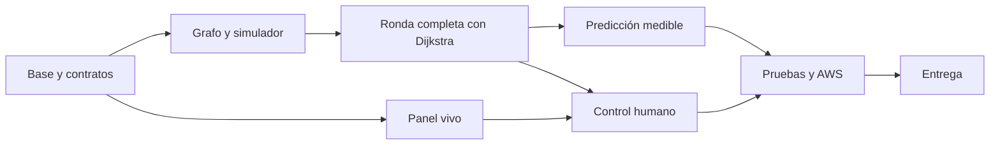

# Plan de implementación vigente

Estado: implementación secuencial en `master`, con commits individuales por fase según instrucción del usuario. CAM-129 configura CD de la demo Lightsail después de CI; primer run remoto y acceso de red seguro siguen pendientes. P5-04 tiene integración local parcial (CAM-039..046); siguen persistencia/reinicio, recorrido integral accesible y seguridad productiva. Última revisión: 2026-10-28. Fuentes: [contexto](../producto/contexto.md), [reto](../referencias/reto-original.md) y [decisiones](../arquitectura/decisiones/README.md). El [plan previo](../referencias/plan-previo.md) es histórico; los documentos especializados actuales son la fuente de cada contrato o regla.

Nombre vigente: **Navira**. Al crear el backend usar la raíz propuesta `src/navira/`; la ruta del plan histórico no es una instrucción actual de nomenclatura. Las tareas funcionales y sus IDs se mantienen.

## Orden y dependencias

Configurar Budget en cuanto se disponga de acceso AWS; desplegar temprano, sin esperar a terminar todos los algoritmos. Los responsables indicados son funciones de equipo, no agentes creados automáticamente.

## Preparación metodológica

Intervención documental solicitada: [SPEC-006](../metodo/especificaciones/SPEC-006-metodologia.md). No completa las fases de aplicación P0–P6.

| ID | Entregable | Estado | Evidencia |
|---|---|---|---|
| M0-01 | Auditar documentos, herramientas y alcance real | Verificado | CAM-004; lectura de repositorio y fuentes. |
| M0-02 | PRD/TRD, modelo OO + DDD, SDD, SPEC y plantillas | Verificado | Documentos y trazabilidad comprobados; SPEC-006. |
| M0-03 | Validadores y regresiones de trazabilidad | Verificado | Ocho regresiones correctas y validadores sin errores. |
| M0-04 | Validación, evidencia y transferencia | Verificado | CAM-004, reporte de SPEC-006 y estado actualizado. |

Elegir especificación y criterios antes de cada tarea; referencias de producto/técnicas en [trazabilidad](../metodo/trazabilidad.md). La autorización actual cubre metodología; las funcionalidades siguen el alcance de la tarea de construcción que se solicite.

## Tareas

Estados permitidos: pendiente, en curso, verificado, bloqueado o descartado con motivo. «Verificado» exige evidencia; al interrumpir trabajo, registrar el estado real y el siguiente paso en [estado actual](estado-actual.md).

| ID | Entregable y responsable | Depende de | Aceptación | Estado |
|---|---|---|---|---|
| P0-01 | Base Python/FastAPI y configuración — backend | Lectura de `AGENTS.md` y `docs/` | Arranque local reproducible, secretos ficticios en ejemplos. | Verificado |
| P0-02 | Esquemas y fixtures — backend/dominio | P0-01 | `/paso` conserva contrato; mapa pequeño y errores definidos. | En curso |
| P0-03 | Budget, permisos y región — operación | Acceso AWS autorizado | CAM-117 verificó Ohio, Budget mensual US$10 y alertas a 50/80/100 % con suscriptor email; verificación de correo pendiente por reporte del usuario. `cloudformation:ValidateTemplate` denegado y permisos de creación no probados. | Parcial; no bloquea preparación local, sí exige control manual de gasto antes de recursos. |
| P0-04 | CI y frontend mínimo — integración | P0-01 | Workflow backend/frontend configurado; CAM-129 añade CD Lightsail que espera ambos jobs y actúa solo desde `master`. Workflow remoto y conectividad aún requieren configuración/verificación. | Implementado localmente; Actions pendiente — CAM-030/129 |
| P0-05 | Primer despliegue — operación | P0-03 y base mínima | CAM-116 valida imagen/`/salud` local; CAM-118 prepara runner efímero sin listener; CAM-119 confirma que IAM deniega validación y Change Set. Falta staging web, TLS, dominio, permisos y despliegue AWS/URL. | Pendiente — artefactos locales en CAM-116/118/119 |
| P1-01 | Grafo Manta y refugios — dominio | P0-02 | Unas 300 intersecciones, barrios conectados, distancias y direcciones válidas. Fixture ampliado en CAM-073: 44.590 nodos/94.146 sentidos en envolvente con margen del cantón; cuatro puntos finales Zona Segura de mapas tsunami. Falta auditar calles, rutas peatonales, límites y parámetros/amenazas oficiales. | Implementada parcialmente — CAM-073; auditoría territorial pendiente |
| P1-02 | Entidades, modos e intenciones — dominio | P0-02 | Un mundo y un resolutor para humano/automático. | En curso |
| P1-03 | Zombies y mordidas — simulación | P1-02 | T-01 a T-06 cubiertas, visibilidad validada y supuestos identificados. CAM-078 añade el búfer topológico de una cuadra en Manta (T-40); CAM-080 conserva y expone conteo confirmado por resolución (T-42). Reglas oficiales de zombies siguen parcialmente provisionales. | En curso |
| P1-04 | Reloj, eventos y snapshots — simulación | P1-03 | Turnos versionados; bootstrap demo, caso de uso y CLI local completan rondas en memoria. Reloj continuo/durable pendientes. | En curso |
| P1-05 | Escenarios estocásticos — simulación | P1-01 y P1-04 | Demo genera semilla nueva si se omite; intensidad baja/media/alta escala una población sintética de zombies distribuida por sectores, conserva composición por perfil y puede activar cierres viales reproducibles visibles al aplicarse. T-28/T-29/CAM-057 documentan perfiles y cierres; CAM-082/T-44 añade cantidad 1–10 reproducible y alerta/cierre antes de decisiones. Parcial: densidad oficial P-09, movimiento de horda P-07, persistencia/replay integral y evaluación HTTP/carga pendientes. | En curso |
| P2-01 | Dijkstra y selección de refugio — rutas | P1-01 | Núcleo genérico considera tipo/distancia, cierres y peligros visibles; falta validar mapa real. | En curso |
| P2-02 | `/paso` y API key — backend | P2-01 y P1-04 | Demo explícita recomienda ruta por HTTP sobre un snapshot activo; mundo oficial, idempotencia durable y operación completa pendientes. | En curso |
| P2-03 | Integración y referencia — integración | P2-02 y P1-05 | CAM-098/CAM-099 ejecutan tres campañas locales R1/R2/R3 con 150 turnos activos por ronda: 69.572 respuestas HTTP 200, cero errores y eventos R2/R3 aplicados. Semillas, densidad y calendario de eventos siguen siendo aproximaciones; repetición en entorno remoto/AWS pendiente. Otra semilla podría terminar antes. | Implementada parcialmente — CAM-098/099; AWS pendiente |
| P3-01 | Búsqueda temporal acotada — rutas | P2-03 (referencia parcial disponible) | Núcleo `(nodo, turnos)` con espera, horizonte configurable, tope de expansiones/tiempo y reporte de medición local; ruta truncada no reemplaza la base. Sin integración HTTP ni predicción. | Verificado — CAM-033 |
| P3-02 | Pronóstico observable — rutas | P3-01 | No conoce dormidos ni fase privada; produce ocupación y supuestos de modelo para el horizonte temporal. El pronóstico actual es exploratorio: caminantes mezclan fases, sobrevivientes de corredor quedan fijos y horda estática es provisional. | Implementado parcialmente — CAM-034; comparación en P3-03 pendiente |
| P3-03 | Selección de política — integración | P3-02 | CAM-058 conecta temporal riesgo-primero; CAM-059 agrega cruces futuros y trayecto preview/acción; CAM-060 mantiene terminal evacuación; CAM-061 asigna rutas conjuntamente por snapshot; CAM-062 limita el puntaje al horizonte; CAM-084 conserva compromiso de ruta; CAM-104 invalida toda ruta comprometida que intersecte bloqueos, conserva los vecinos topológicos de horda ante cierres y penaliza suavemente la proximidad zombie (T-55); CAM-141 busca un refugio alternativo alcanzable si el asignado pierde toda ruta legal (T-63). Ampliar semillas/duración, T-22, T-11 y evaluación sobre Manta siguen pendientes; T-46 integral también. | Implementada parcialmente — CAM-104 |
| P4-01 | Panel y mapa — frontend/backend | P0-04 y contratos | Mapa/snapshot observables, filtro de dormidos, capas, refugios, cierres/hordas, movimientos, métricas por modo, ruta prevista seleccionable al pulsar el habitante, ficha del snapshot actual en el panel izquierdo, consulta manual y alerta de incidente aplicado con ruta actualizada (CAM-082/083/085/093, T-44/45). Actualización en vivo corresponde a P4-02. | Verificado parcialmente — CAM-093; falta smoke visual de selección |
| P4-02 | WebSocket y recuperación — frontend/backend | P1-04 y P4-01 | Snapshot completo al conectar/cambiar versión, heartbeat y reconexión desde versión vigente; filtra origen ajeno y no cruza runId. Almacenamiento del socket en memoria, sin replay durable/multi-worker. | Verificado — CAM-032 |
| P4-03 | Tablero y operación local del simulador — integración | P4-01/P4-02 | UI de tablero para observar/controlar demo automática local mediante flujo de inicio, selección obligatoria de cuatro refugios y conteos de 1–200 habitantes/zombies. Escenario mixto y velocidad fija 4×; pausa, continuación y reinicio permanecen. Incidentes siempre activos, con alerta/marcador al aplicarse. 4× no omite rondas y el control no es público. | Verificado parcialmente — CAM-063/079/081/100; smoke visual pendiente |
| P4-04 | Cartografía base y render 3D — frontend | P4-01/P4-03 | Mapa vectorial OSM con zona jugable derivada dentro del recorte CAM-076; apariciones, amenazas, rutas y movimientos permanecen en el subgrafo; cámara y selector comparten límites, y el backend rechaza refugios exteriores. El fixture fuente se conserva; la caja no es frontera municipal certificada. «Vista urbana»/«Ver partida», seguimiento WebSocket, agua y extrusión siguen vigentes. | Implementada parcialmente — CAM-051/052/053/054/055/056/073/074/075/076/077; falta inspección visual y prueba de falla del proveedor, además de medir payload/cadencia en entorno objetivo. |
| P4-05 | Flujo Reto separado de demo libre — frontend/backend | P4-03, P2-03 | Presets de 20/80/200 con motor automático compartido, composición/eventos reproducibles por semilla, spawn en cuatro zonas aproximadas, foco central provisional y controles por estado. CAM-098/CAM-099 ejecutan campaña local tres veces, nueve rondas y 150 turnos activos por ronda. Geometría/densidad oficiales, automatización desde UI, posibles terminaciones tempranas con otras semillas, persistencia y AWS siguen pendientes. | Implementado parcialmente — CAM-088/094/095/096/097/098/099 |
| P4-06 | Juego de operador sobre mundo vivo — frontend/backend | P4-01/P4-02/P4-03 | Reto/Simulador/Juego separados; Juego arranca una demo local automática con mapa vial vacío y permite agregar entidades, refugios e incidentes, validados en servidor y versionados por CAS. Comparte el planificador del Simulador: incidentes y hordas filtran rutas, zombies próximos elevan riesgo y los compromisos se revalidan. El operador puede reemplazar un mundo activo/pausado por una partida nueva vacía. Al iniciar el modo destino, Reto, Simulador y Jugar reemplazan el único run anterior por uno nuevo; cambiar de pestaña no altera el mundo. Reto no admite colocaciones y un Reto activo no se sustituye con otro inicio Reto. Operación pública/productiva queda fuera. CAM-101..106 cubren API, inicio vacío, reemplazo, transición limpia, cierre visual y paridad parcial; falta smoke visual total T-53 y regresión de concurrencia/pausa prolongada. | Implementado parcialmente — CAM-105 |
| P4-07 | Demo pública multisesión | P4-01/P4-03/P4-06 | Una sesión anónima por navegador, cookie segura y hash en servidor; cada sesión mantiene su mundo aislado para Reto, Simulador y Juego. Capacidad concurrente limitada, expiración por inactividad, topes de población y de peticiones; sin persistencia tras reinicio. | Implementada parcialmente — CAM-126..128; carga/abuso y revisión visual de Jugar pendientes |
| P4-08 | Precarga del mapa y pausa confirmada | P4-01/P4-03/P4-04 | La geometría estática se solicita en segundo plano y se reutiliza por `mapVersion`, sin bloquear shell/controles ni confundir capas dinámicas de otro `runId`. La pausa muestra un estado pendiente y solo se confirma al recibir acuse del servidor; se comprueba que no comience otro turno después del acuse y que continuar use el mismo run. Medir tiempo visible del mapa y latencia del acuse con procedimiento comparable; no declarar metas cumplidas por percepción o compilación. | Implementada parcialmente — CAM-134; build/compile comprobados, T-59/T-60, smoke y medición pendientes |
| P4B-01 | Sesión y aparición humana — backend | P2-03 | Un propietario, nodo aleatorio elegible y entrada al inicio de turno. CAM-036 implementa sesión local; CAM-043 recupera personaje y posición por cookie tras recarga; CAM-046 aplica TTL deslizante local de 30 min y tombstone para no transferir el personaje. Política productiva, revocación y persistencia durable/reinicio pendientes. | Implementada parcialmente — CAM-046 |
| P4B-02 | Órdenes idempotentes — backend | P4B-01 | `POST /juego/accion` valida sesión, propiedad, modo, fase, turno y topología; el mismo `accionId` devuelve el acuse original y la última orden válida sustituye la anterior. CAM-037 cubre memoria local; reloj/cierre atómico, consumo por coordinador y persistencia durable pendientes. | Implementada parcialmente — CAM-037 |
| P4B-03 | Controles y resultado — frontend | P4-02 y P4B-02 | CAM-038 implementa UI inicial por teclado/mouse y acuse; CAM-041 timer, CAM-042 radio, CAM-043 recuperación local, CAM-045 skip link/foco/anuncio de deadline y CAM-047 recorrido manual parcial de Tab/Enter/Space en selección. Falta probar orden/resultado end-to-end, lector de pantalla y T-19 integral. | Implementada parcialmente — CAM-047 |
| P5-01 | Ráfagas y reloj — integración | P2-03 y política elegida | p95 objetivo ≤150 ms, errores <0,5 %, ciclo dentro de dos segundos. CAM-098/CAM-099: tres campañas locales, nueve rondas, 150 turnos activos cada una, 69.572 respuestas HTTP 200, p95 de `/paso` máximo 64,313 ms y ciclo máximo 1.676,531 ms. Revisar evidencia para límites por semilla. Repeticiones adicionales o en AWS/entorno oficial aún pueden revelar variación. | Implementada parcialmente — CAM-044/CAM-087/CAM-098/099; AWS pendiente |
| P5-02 | Seguridad/red/TLS — operación | P0-05 y contratos finales | Permisos, origen y sesión probados; sin claves maestras en navegador. ADR-046: demo pública TLS de tres modos y cookie aislada, smoke HTTPS verificado. ADR-047/050: CD tras CI, host key fijada, OIDC acotado a `master`, rol IAM mínimo, SSH temporal `/32`, configuración en servidor y rollback local. Pendiente configurar provider/rol/variable GitHub y verificar primer run. Siguen faltando carga/abuso, inspección visual de Jugar y acceso de solo lectura a estado AWS/Billing. `/paso` mantiene API key. | En curso — CAM-126..140 |
| P5-03 | Tres rondas en AWS — integración | P5-01, P5-02 y panel | Campaña R1/R2/R3 completada en tarea Fargate; reporte con ventanas de 300 s, 22.767 HTTP 200, cero fallos y limitación loopback. Medición remota al endpoint, campaña oficial y repetición siguen pendientes. | Parcial — CAM-125 |
| P5-04 | Juego y recuperación — integración | P4B-03 y P5-02 | T-12 a T-19; una recarga no revive ni duplica control. CAM-039/040 conectan coordinador, deadline de 1,7 s, runner de 2 s y modo sintético opt-in; CAM-041 muestra el tiempo del servidor, CAM-042 agrega radio, CAM-043 recuperación local y CAM-046 caducidad local sin transferir personaje. Persistencia/reinicio, TLS y T-14/T-15/T-19 integral siguen pendientes. | Implementada parcialmente — CAM-046 |
| P6-01 | README y evidencias — integración | Ejecución real | Instalación, API, despliegue y métricas reproducibles. | Pendiente |
| P6-02 | Diagrama/costos/Budget — operación | Recursos reales | SVG/PNG y fuente, cálculo completo y gasto real. | Pendiente |
| P6-03 | Pitch y entrega — equipo | P5-03, P5-04, P6-01, P6-02 | PDF/PPT ≤20 MB, enlaces públicos y entrega anticipada. | Pendiente |

Los objetivos son metas, no garantías ni resultados ya existentes. Detalles de aceptación en [pruebas](../calidad/pruebas.md). El juego es parte del alcance solicitado; capacidad de refugios y camionetas no están comprometidas todavía.

## Cronograma propuesto

Fechas del reto: entrega miércoles 28-10-2026 a las 10:00, Ecuador continental. Ventanas orientativas heredadas del análisis; al retomarlas, contrastar hora/fecha reales y replanificar lo pendiente sin fingir que el trabajo previsto ya ocurrió.

| Ventana | Objetivo |
|---|---|
| Lunes 26 | Contratos, Budget, base, grafo y primera ronda integrada en AWS. |
| Martes 27, mañana | Reglas completas, tres escenarios, panel y entrada humana mínima. |
| Martes 27, tarde | Predicción, juego integrado, ráfagas y correcciones. |
| Martes 27, noche | Congelar funcionalidades y completar evidencia/documentación. |
| Miércoles 28, 07:30–09:00 | Verificación final y pitch. |
| Miércoles 28, 09:00–09:30 | Enviar y comprobar entrega. |
| Miércoles 28, 09:30–10:00 | Margen de incidencias. |

Equipo orientativo: A dominio/simulador; B rutas/API; C frontend/operación/documentación, con revisión compartida del despliegue. Con dos personas, dividir núcleo y producto/infraestructura. Con una, mantener pasos secuenciales y panel/juego mínimos; reducir primero extras y refinamientos.

## Recortes y bloqueos

- Sin una ronda completa, no empezar camionetas o capacidad.
- Si predicción empeora resultados, conservar política mejor medida y registrar comparación.
- Si CPU/latencia falla, revisar I/O y trabajo repetido, reducir horizonte y después dimensionar.
- Reducir efectos, personalización y ayudas avanzadas del juego antes de sus validaciones de control.
- Dudas externas no bloquean núcleo local; mantener supuestos configurables en [pendientes](pendientes.md).
- No crear Redis, colas, réplicas o nuevas capas sin problema demostrado y decisión registrada.

## Checklist de entrega

- [ ] Repositorio público e historial real de commits.
- [ ] README raíz reproducible con endpoint `/paso`, autenticación y medición.
- [ ] Simulador completo, mapa vivo y tres rondas en AWS.
- [ ] Selector de modos y juego humano mínimo verificado.
- [ ] Métricas del juego separadas de la prueba automática.
- [ ] Arquitectura exportada y fuente en `docs/`.
- [ ] Budget con alerta y evidencia en `docs/evidencias/`.
- [ ] Costo mensual completo y gasto real diferenciados.
- [ ] Supuestos y limitaciones conocidos, sin resultados inventados.
- [ ] Pitch válido, enlaces comprobados y URL disponible hasta la presentación.

El uso de `docs/` difiere de la estructura sugerida `docs/` del reto; el documento admite una estructura sugerida. README y entrega deben enlazar las ubicaciones reales.
